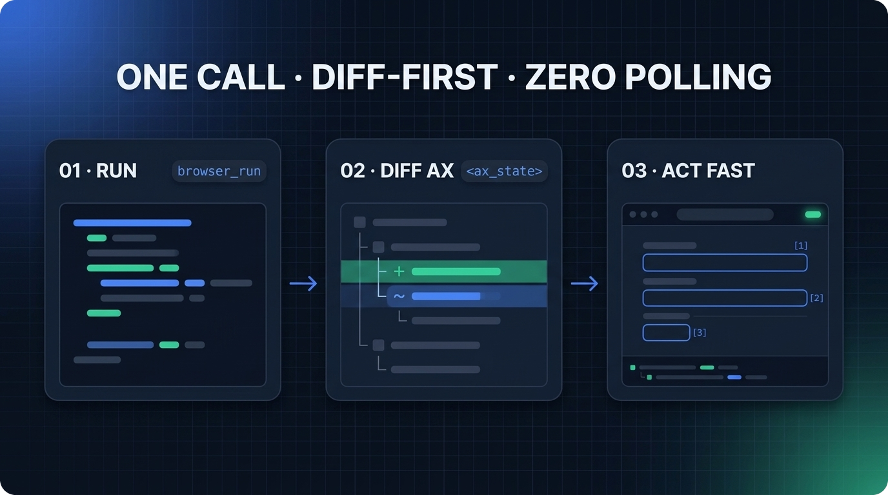

<div align="center">


# codex-browser-use

### One fast local MCP that gives any coding agent your real Chrome browser.

**Codex's Browser Use feature is so good — so I cloned it and made a faster, open-source version for every coding agent.**

**English** · [Tiếng Việt](docs/i18n/README_vi.md) · [简体中文](docs/i18n/README_zh-CN.md) · [日本語](docs/i18n/README_ja.md) · [한국어](docs/i18n/README_ko.md)

[](LICENSE)
[](https://www.npmjs.com/package/codex-browser-use)
[](https://codex-browser-use.vercel.app)
[](#quick-start)
[](#why-its-better)
[](#quick-start)
[](https://github.com/khanhle1406/codex-browser-use/stargazers)

[Website](https://codex-browser-use.vercel.app) · [Quick start](#quick-start) · [How it works](#how-it-works) · [What you can do](#what-you-can-do) · [Why it's better](#why-its-better) · [FAQ](#faq) · [Documentation](#documentation)

<code>npx -y codex-browser-use install --client antigravity --write --skill</code>

</div>

<div align="center">

<br />


</div>

---

Want your coding agent to open a website, click buttons, fill out forms, and test if your app actually works? Usually that means installing Playwright, launching a heavy extra browser, and burning through your token limit on giant HTML dumps and screenshots.

OpenAI Codex solved this cleanly by connecting straight to your real Chrome browser and reading pages as a short numbered list instead of raw HTML. The only catch is that it only works inside Codex. So I cloned the idea from scratch as a free, open-source tool that works with **any coding agent** — and tuned it to run even faster.

Setup takes one command. It installs a small Chrome extension, registers the local bridge, and installs the complete agent skill bundle and always-on rules automatically. Your agent works right inside your currently open Chrome — keeping your existing cookies and signed-in sessions — while leaving your own open tabs and ongoing work completely untouched.

## Quick start

You need **Node.js 26.12.1 or newer**, npm, and Chrome (or Chromium, Edge, or Brave).

### Set up your agent

**Option 1 — 1-command install via npm (fastest):**

```sh
# Quick run via npx (or install globally with `npm install -g codex-browser-use` for a permanent binary path)
npx -y codex-browser-use install --client antigravity --write --skill
npx -y codex-browser-use doctor --json
```

Install just the Agent Skill (`SKILL.md` + cookbook) into any compatible client via [`skills.sh`](https://skills.sh):

```sh
npx skills add https://github.com/khanhle1406/codex-browser-use
```

**Option 2 — From source (`git clone`):**

```sh
npm --prefix mcp-server ci
node mcp-server/bin/browser-use.js install --client antigravity --write --skill
node mcp-server/bin/browser-use.js doctor --json
```

`install --skill` copies the Chrome extension (`v0.6.4`), registers the local Chrome Native Messaging host, writes your client's MCP config (saving a `.bak` backup first), installs the full skill bundle (`skill/SKILL.md` + `skill/references/cookbook.md` + `skill/references/tools.md`), and automatically installs the always-on rules file (`rules/browser_use.md`, or `.cursor/rules/browser_use.mdc` for Cursor) when supported (pass `--no-rules` to skip, or `--rules` standalone).

<details>
<summary><strong>Supported clients &amp; tool profiles (<code>--profile auto | compact | standard | full</code>)</strong></summary>

| Client | MCP Config | Skill Folder | Rules Installed by `--skill` |
| --- | --- | --- | --- |
| `antigravity` | `~/.gemini/config/mcp_config.json` | `~/.gemini/config/skills/codex-browser-use/` | `~/.gemini/config/rules/browser_use.md` |
| `commandcode` | `~/.commandcode/mcp.json` | `~/.agents/skills/codex-browser-use/` | `~/.agents/rules/browser_use.md` *(recommend `--profile compact` or `auto`)* |
| `cursor` | `~/.cursor/mcp.json` | `~/.cursor/skills/codex-browser-use/` | `~/.cursor/rules/browser_use.mdc` *(with Cursor frontmatter)* |
| `windsurf` | `~/.codeium/windsurf/mcp_config.json` | `~/.codeium/windsurf/skills/codex-browser-use/` | `~/.codeium/windsurf/rules/browser_use.md` |
| `copilot` | `~/.copilot/mcp-config.json` | `~/.agents/skills/codex-browser-use/` | `~/.agents/rules/browser_use.md` |
| `claude_code` | `~/.claude.json` | `~/.claude/skills/codex-browser-use/` | *(skipped)* |
| `codex` | Print TOML via `config` | `~/.codex/skills/codex-browser-use/` | *(skipped)* |
| `opencode` / `generic` | Print config via `config` | `~/.agents/skills/codex-browser-use/` | `~/.agents/rules/browser_use.md` |

For non-lazy CLI clients (Codex, Claude Code, Command Code, Copilot, OpenCode), pass `--profile auto` (auto-picks `"compact"` for CLIs and `"full"` for lazy-loading IDEs) or `--profile compact` / `BROWSER_USE_TOOL_PROFILE=compact` to register only the 7 core tools and cut fixed tool schema size by **75.4%** (`7,457` bytes / `~1,865` est. tokens vs `30,302` bytes / `~7,576` est. tokens):

```sh
node mcp-server/bin/browser-use.js install --client commandcode --write --skill --profile auto
node mcp-server/bin/browser-use.js config --client codex --profile auto
```

For Codex or OpenCode, print the config snippet and install the skill:

```sh
node mcp-server/bin/browser-use.js config --client codex
node mcp-server/bin/browser-use.js config --client opencode
node mcp-server/bin/browser-use.js install --client codex --skill
```

</details>

### Connect Chrome

1. Open `chrome://extensions`, turn on **Developer mode**, click **Load unpacked**, and choose `~/.local/share/browser-use/extension`.
2. That's it — **Portable Browser Bridge** connects automatically in the background (hover the icon to check status, or click to pause/reconnect).
3. Restart your coding agent so it loads the MCP tools.

### Ask your agent

Once connected, just ask in plain English:

```text
Open http://127.0.0.1:3000 in a Chrome tab group called "App QA".
Test the signup form on desktop and mobile sizes, check for any console
or failed network errors, save an element screenshot of the signup card,
and leave the final tab open for me to check.
```

## How it works

### 1. Everything stays on your computer

Your agent talks to a local MCP server (`v4.8.1`), which sends commands straight into your running Chrome browser through a lightweight extension (`v0.6.4`). There is no cloud service, no Playwright browser download, and no hidden background server.


### 2. One turn, tiny token usage, zero wasted waiting

Instead of taking one tiny step per AI message, your agent can run a whole multi-step flow (up to `300,000` ms / `5` min per `browser_run` call) and even process up to `10` URLs in parallel (`browser.tabs.content()`). Page snapshots default to `mode: "compact"` (with `"full"` and `"interactive"` available) across `browser_run`, `browser_batch`, and `ariaSnapshot()`, share a unified AX diff baseline across `ariaSnapshot()` and `getState()`, support scoped `locator.ariaSnapshot()` subtrees (such as a single dialog or card), structured content export (`browser_get_content` & `page.content.export()` / `.tables()` / `.links()`), CSS-scaled screenshots (`max_width` default `1280` px, JPEG quality `75`), and diff-only updates — keeping token usage tiny.

In `v4.7.0`–`v4.8.1`, `browser_run` adds zero-bloat local file helpers (`saveFile`, `readFile`, `saveScreenshot` with `emit: true`, `nodeRepl` alias) that auto-report `saved_files` metadata, tightly clipped `locator.screenshot()` / `page.elementScreenshot()`, `tab.ax.paste()` / `tab.ax.selectText()`, `page.innerText()` / `page.textContent()` / `page.check()` shorthands, read-only `evaluate()` support for local `{}`/`[]` container builds, network response body capture via `tab.dev.enableNetwork({ captureBodies: true })` + `tab.dev.responseBody(requestId)`, consolidated auto-uncollapsing Chrome Tab Groups, and `--profile auto` client selection.



<details>
<summary><strong>Example: parallel multi-URL extraction, file output, and element Proof of Work</strong></summary>

```json
{
  "name": "browser_run",
  "arguments": {
    "return_state": "none",
    "end_turn": true,
    "code": "await browser.nameSession('Docs Audit', 'cyan');\nconst pages = await browser.tabs.content([\n  'https://example.com/docs',\n  'https://example.com/pricing'\n], { format: 'markdown', concurrency: 2 });\nconst saved = await saveFile('/abs/path/docs-export.json', pages);\nconst pricingTab = await browser.tabs.new('https://example.com/pricing');\nawait pricingTab.locator('css=.plan-card').first().saveScreenshot('/abs/path/plan-card.png', { padding: 12, emit: true });\nawait pricingTab.markDeliverable();\nreturn { extracted: pages.length, file: saved.path };"
  }
}
```

Or pass a list of steps (`goto`, `set_viewport`, `locator_fill`, `locator_click`, `wait`, `get_state`, `get_content`, `read_tab`, `evaluate`) to `browser_batch`.

</details>

### 3. Control existing open tabs or isolated agent tabs — with non-blocking virtual cursor

Your agent can open fresh tabs in its own colored Chrome Tab Group (with `target="_blank"` popups auto-claimed and observable via `page.waitForEvent("popup")`), read an open user tab passively without attaching the Chrome debugger (`browser.tabs.read(id)` / `browser.user.getTabContext(id)` and passive `browser_get_content` via `chrome.scripting.executeScript`), or claim a specific matching tab you already have open. While your agent works, a virtual cursor and tab badge show where it clicks and types (`BROWSER_USE_CURSOR_MODE=fast|smooth|off`; `fast` is default with `0` ms blocking). When the task finishes, temporary agent tabs close automatically while your own tabs are safely released and left open.


## What you can do

| What you want to do | How it helps |
| --- | --- |
| **Test your web app** | Fill out forms (including rich-text smart fill for CKEditor 4/5, TinyMCE, Quill, `contenteditable`, and `ax.paste`/`ax.selectText`), test mobile/desktop viewports, capture element screenshots (`locator.screenshot()`), and inspect console errors or API response bodies (`dev.responseBody()`). |
| **Scrape & check multiple pages cleanly** | Extract up to `10` URLs in parallel (`browser.tabs.content()`), run 5-minute (`300s`) pagination loops, save bulk results to disk with `saveFile()` without bloating chat context, and read `page.assets.list()` or WebMCP tools (`page.webmcp`). |
| **Click tricky UIs** | Works inside Shadow DOM, same/cross-origin iframes (OOPIFs), file upload pickers, and long file downloads, with closest-locator fallback hints on `not_found` timeouts. |
| **Keep Chrome neat** | Group an agent's tabs under a named, colored Chrome tab label while temporary tabs clean themselves up automatically. |
| **Handle logins & CAPTCHAs safely** | Never tries to bypass security checks — the agent pauses (`handoff`) and leaves the tab open so you can sign in yourself. |

## Why it's better

| Feature | Playwright / Screenshot MCPs | Codex Built-in Browser Use | `codex-browser-use` |
| --- | :---: | :---: | :---: |
| Works with any coding agent | ✅ | ❌ Codex only | ✅ Any MCP agent |
| Uses your real Chrome (no extra browser) | ❌ Heavy extra browser | ✅ | ✅ |
| 100% open-source MIT (no closed binary) | ✅ | ❌ Closed runtime | ✅ Pure Node.js + MV3 |
| Multi-step scripts & parallel tabs in 1 call | ❌ One step per turn | ✅ | ✅ + `tabs.new` & `tabs.content` |
| Short numbered outlines + local `saveFile` | ❌ Huge DOM / PNGs | ✅ | ✅ Diff-first + `mode` compression |
| Named Chrome Tab Groups | ❌ | ✅ | ✅ |
| Fast local speed without timer polling | ❌ Slow per-step wait | ✅ | ✅ Up to 6.83x faster in parallel |

Under the hood, commands run in parallel over the local bridge and wait directly on Chrome page events instead of polling on timers — making 4-tab parallel runs **6.83x faster** and full page + iframe + screenshot reads **~3x faster**. Across `v4.6.0`–`v4.8.1`, the persistent in-page locator runtime cache (`globalThis.__buRt` v2) cuts 10 warm locator payloads from `379,520` bytes to `1,260` bytes (**99.7% reduction**), `compact` AX snapshots shrink output by **81.7%** (`3,812` → `699` chars), `markdown` content extraction shrinks raw text by **94.1%** (`1,524` → `90` chars), and `--profile compact` cuts MCP tool schema size by **75.4%**. In a live end-to-end Chrome agent benchmark on the exact same model (`gpt-6.1-terra`, medium), `codex-browser-use` (`--profile compact`) completed the 4-task suite **28.8% faster** (`55.79s` vs `78.38s`) with **3.80x faster** browser execution (`3.48s` vs `13.21s`) and **51.9% fewer total input tokens** (`305,934` vs `636,008`) than Codex's built-in Chrome plugin.

<details>
<summary><strong>See full benchmark numbers &amp; run it yourself</strong></summary>

#### Live Same-Model Agent Benchmark (`gpt-6.1-terra medium`, Real Chrome)

Measured end-to-end with [agent-benchmark.mjs](mcp-server/bench/agent-benchmark.mjs) against a deterministic 4-task Chrome portal (2-page modal scraping, Shadow DOM + `contenteditable` form submission, screenshot Proof of Work, and token audit; both scored **100/100**):

| Metric | Codex Built-in Chrome Plugin (`node_repl:js`) | `codex-browser-use v4.8.1` (`--profile compact`) | Verified Gain |
| --- | ---: | ---: | --- |
| **Grade** | `100 / 100` | **`100 / 100`** | Equal accuracy (`8/8` modals, `1` submit) |
| **Total Wall-Clock** | `78.38s` (`78,380 ms`) | **`55.79s`** (`55,792 ms`) | **28.8% faster** (`-22.59s`) |
| **Time to First Browser Action (TTFA)** | `28.65s` (`28,646 ms`) | **`12.86s`** (`12,860 ms`) | **55.1% faster** |
| **Browser Execution Time** | `13.21s` (`13,207 ms`) | **`3.48s`** (`3,476 ms`) | **3.80x faster** (`-73.7%`) |
| **Browser Tool Calls** | `12` | **`8`** | **33.3% fewer calls** |
| **Total Input Tokens (incl. cache)** | `636,008` | **`305,934`** | **51.9% fewer tokens** |
| **Uncached Input Tokens** | `52,584` | **`20,494`** | **61.0% fewer uncached tokens** |

Run the live agent benchmark on Chrome (`same-model`, `head-to-head`, or `all`):

```sh
npm --prefix mcp-server run bench:agents -- --mode same-model
```

#### Core IPC &amp; Payload Micro-Benchmarks

Measured on Node `v26.13.0` with [perf-benchmark.mjs](mcp-server/bench/perf-benchmark.mjs) using real local sockets, Native Messaging streams, in-memory MCP transport, and simulated page latencies held identical before vs. after optimization:

| What was measured | Before / Baseline | After / Optimized | Verified Gain |
| --- | --- | --- | --- |
| **4 Parallel Tabs** (`goto` + read page) | `606.79 ms` | **`88.86 ms`** | **6.83x faster** (`-85.4%`) |
| **Page + 4 Iframes + Screenshot** | `267.63 ms` / `226.38 ms` | **`90.88 ms`** / **`72.59 ms`** | **2.94x** cold / **3.12x** warm |
| **Wait for Page Load** (+ assets) | `130.54 ms` (`10` polls) | **`113.58 ms`** (**`0`** polls) | **Zero polling checks** |
| **Wait for Element & Text** (`90ms` delay) | `406.74 ms` (`8` checks) | **`289.37 ms`** (`3` checks) | **1.41x faster** / `-62.5%` calls |
| **Fill 10 Fields in a Row** | `399.85 ms` (`40` calls) | **`187.89 ms`** (`20` calls) | **2.13x faster** (half the calls) |
| **Click 10 Times Inside an Iframe** | `494.31 ms` (`51` calls) | **`151.28 ms`** (`15` calls) | **3.27x faster** (`-70.6%` calls) |
| **Extension Stream & 40 Large Replies** | `34.18 ms` / `120` msgs | **`26.57 ms`** / **`40` msgs** | `-22.3%` CPU / **`-66.7%` msgs** |
| **40 MB Over Local Socket** | `263.01 ms` (`152.1 MB/s`) | **`132.20 ms`** (**`302.6 MB/s`**) | **~2.0x throughput** |
| **Locator Runtime Cache (`10` calls)** | `379,520 B` (`2.73 ms`) | **`1,260 B`** (**`1.13 ms`**) | **99.7% smaller payload** |
| **MCP Tool Schema (`compact` vs `full`)** | `30,302 B` (`~7,576` tok, `36` tools) | **`7,457 B`** (**`~1,865` tok, `7` tools**) | **75.4% smaller schema** |
| **AX `compact` & Markdown Content** | `3,812` AX / `1,524` text chars | **`699`** AX / **`90`** md chars | **81.7%** AX / **94.1%** content saved |

Run the benchmark locally:

```sh
npm --prefix mcp-server run bench
```

</details>

<details>
<summary><strong>View all 36 MCP tools &amp; tool profiles (compact / standard / full)</strong></summary>

Use `--profile compact|standard|full` (or `BROWSER_USE_TOOL_PROFILE`): **`compact`** registers 7 core tools (`browser_run`, `browser_batch`, `browser_get_state`, `browser_goto`, `browser_list_tabs`, `browser_screenshot`, `browser_end_turn`, cutting fixed tool schema size by `75.4%` from `30,302 B` / `~7,576` tokens to `7,457 B` / `~1,865` tokens); **`standard`** registers 14 tools (`~3,023` tokens); **`full`** (all 36 tools) is the default for lazy-loading clients.

| Group | Tools |
| --- | --- |
| **Multi-step & Status** (`3`) | `browser_run`, `browser_batch`, `browser_status` |
| **Read & Debug** (`8`) | `browser_get_state`, `browser_screenshot`, `browser_get_content`, `browser_dom_snapshot`, `browser_inspect_element`, `browser_console_logs`, `browser_network_logs`, `browser_evaluate` |
| **Click, Type & Files** (`9`) | `browser_click`, `browser_set_value`, `browser_type_text`, `browser_press_key`, `browser_select_option`, `browser_hover`, `browser_drag`, `browser_scroll`, `browser_upload_files` |
| **Smart Locators, Waits & Screen Size** (`4`) | `browser_locator_click`, `browser_locator_fill`, `browser_wait_for`, `browser_set_viewport` |
| **Navigation, Tabs & Groups** (`9`) | `browser_goto`, `browser_back`, `browser_forward`, `browser_reload`, `browser_list_tabs`, `browser_new_tab`, `browser_select_tab`, `browser_close_tab`, `browser_name_session` |
| **Popups & Cleanup** (`3`) | `browser_handle_dialog`, `browser_end_turn`, `browser_reset` |

</details>

## FAQ

<details>
<summary><strong>Which coding agents work with this?</strong></summary>

Any agent that supports local MCP tools: Antigravity, Claude Code, Codex CLI, Cursor, Windsurf, GitHub Copilot CLI, Command Code, OpenCode, or custom setups.

</details>

<details>
<summary><strong>Can the agent see my personal tabs or saved passwords?</strong></summary>

By default, the extension creates isolated tabs for the agent session and leaves your personal tabs, bookmarks, and unrelated windows untouched. When you explicitly ask to inspect an existing tab, passive reads (`browser.tabs.read(id)` / `browser.user.getTabContext(id)` / passive `browser_get_content`) run without attaching the Chrome debugger, and read-only page checks (`browser_evaluate`) block page edits, storage writes, and network calls.

</details>

<details>
<summary><strong>Why not just use Playwright MCP?</strong></summary>

Playwright installs heavy separate browsers, starts cold with no cookies or logins every time, and often sends large DOM dumps or full PNGs per action. `codex-browser-use` connects straight to your running Chrome — keeping your existing cookies, signed-in sessions, and ongoing work untouched — with short page outlines, named Tab Groups, local `saveFile`/`saveScreenshot`, and 1-call scripts.

</details>

<details>
<summary><strong>What happens on login pages, 2FA, or CAPTCHAs?</strong></summary>

Agents are told never to bypass logins or CAPTCHAs. When a page needs you to sign in, the agent pauses (`handoff`) and asks you to complete it in Chrome yourself, then picks right back up.

</details>

<details>
<summary><strong>How do I update or check if everything is working?</strong></summary>

Pull the latest code, run `node mcp-server/bin/browser-use.js install --client <your-client> --skill`, click **Reload** on **Portable Browser Bridge** in `chrome://extensions`, and run `node mcp-server/bin/browser-use.js doctor --json`.

</details>

## Documentation

Run tests, lint, and health checks anytime:

```sh
npm --prefix mcp-server test
npm --prefix mcp-server run lint
npm --prefix mcp-server run bench
npm --prefix mcp-server run bench:agents -- --mode same-model
node mcp-server/bin/browser-use.js doctor --json
```

- [Agent Skill Instructions](skill/SKILL.md) — workflow guide and v4.8.1 API reference installed for your coding agent
- [Workflow Cookbook](skill/references/cookbook.md) — copy-paste recipes for pagination, passive reads, `responseBody()`, and screenshots
- [Tool Profiles & Inventory](skill/references/tools.md) — `--profile auto|compact|standard|full` comparison and full 36-tool list
- [Browser Policy Rule](rules/browser_use.md) — always-on safety and token-efficiency rules
- [Compatibility & Engine Modes](docs/compatibility.md) — standalone setup details
- [Transport & IPC Notes](docs/transport-investigation.md) — how the local socket and native bridge work
- [Legacy v1 Notes](docs/legacy-v1.md) — older v1 architecture reference

## Contributing

Issues and pull requests are welcome at [khanhle1406/codex-browser-use](https://github.com/khanhle1406/codex-browser-use).

## License

[MIT](LICENSE)
