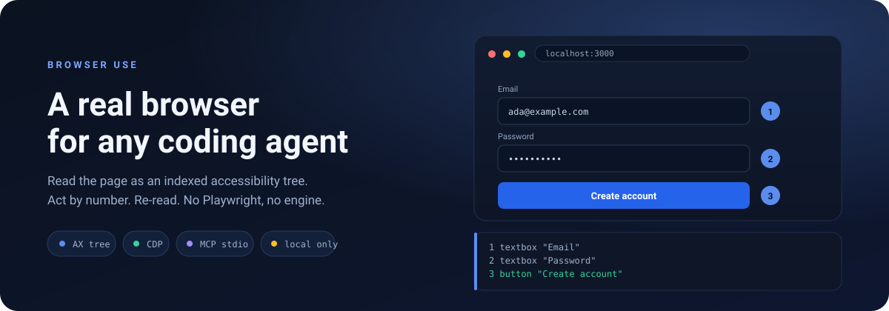
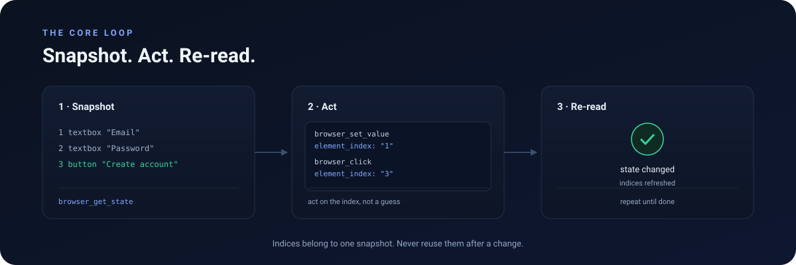
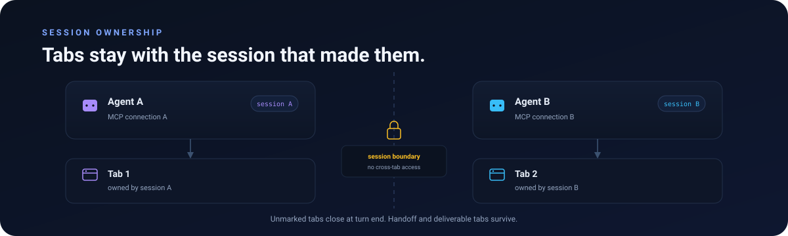

<div align="center">

# Browser Use for any coding agent

### One local MCP server that gives any agent a real Chrome browser.

**Read the page like a person: indexed accessibility tree, act, re-read.**

[](LICENSE)
[](#quick-start)
[](#quick-start)
[](#tools)
[](#verification-and-limitations)
[](https://github.com/khanhle1406/codex-browser-use/stargazers)

[Quick start](#quick-start) · [How it works](#how-it-works) · [What you can do](#what-you-can-do) · [Tools](#tools) · [FAQ](#faq) · [Documentation](#documentation)

<code>node mcp-server/bin/browser-use.js install</code>

</div>

<p align="center">
  
</p>

> [!NOTE]
> No OpenAI engine and no Playwright. The bridge speaks Chrome DevTools Protocol
> directly through this project's own extension and native host.

> [!IMPORTANT]
> This is an experimental tool. The bridge, accessibility actions, locators,
> cross-origin frames, screenshots, sessions, and installer are implemented and
> tested. Live navigation is verified on a normal desktop session; this
> repository's agent sandbox blocks Chrome navigation to loopback and `data:`
> targets. See [Verification and limitations](#verification-and-limitations).

---

Every browser agent fails the same way: it guesses a selector, clicks the wrong
element, and cannot tell what changed. This tool gives the agent eyes. It returns
the page as an indexed accessibility tree, the agent acts on an element by
number, and the next snapshot shows the result.

It works with any MCP-capable coding agent — Command Code, Claude Code, Codex,
OpenCode, Copilot CLI, Antigravity, or a generic client. The server runs locally
over stdio, drives Chrome through a native host and a small extension, and never
needs the OpenAI browser engine or a Playwright install.

The bridge creates its own tabs. It never lists your other tabs, reads your
cookies, or touches a profile it did not create a tab in.

## Quick start

**Requirements:** Node.js **26.12.1 or newer**, npm, and Chrome, Chromium, Edge,
or Brave.

### Install the bridge

From this checkout:

```sh
npm --prefix mcp-server ci
node mcp-server/bin/browser-use.js install --client commandcode --write
node mcp-server/bin/browser-use.js doctor --json
```

`install` copies the extension to `~/.local/share/browser-use/extension`, writes
a private native-host launcher, registers native messaging for the Chrome-family
browsers it finds, and merges one MCP entry into the selected client with a
`.bak` backup. The extension ID is pinned, so there is no ID to copy and no
manual host registration.

> The npm package is prepared but not published yet. Once it is, the same flow is
> `npx agent-browser-use install --client commandcode --write`.

### Connect Chrome

1. Open `chrome://extensions`, enable **Developer mode**, and **Load unpacked**
   from the path the installer printed
   (`~/.local/share/browser-use/extension`).
2. Click the extension's toolbar action once. The badge shows `ON` and the
   bridge publishes `~/.local/share/browser-use/chrome-host/bridge.json`.
3. Clicking the action again disconnects the bridge and closes tabs it still
   owns.

Run `install --client NAME --write` for `claude_code`, `copilot`, or
`antigravity`. `config --client NAME` prints a fragment instead, which is what
Codex (TOML) and OpenCode (JSONC) need:

```sh
node mcp-server/bin/browser-use.js config --client codex
node mcp-server/bin/browser-use.js config --client opencode
```

### Ask your agent

```text
Open http://localhost:3000, read the page, fill the signup form with test data,
submit it, and tell me what the next page shows. Call browser_get_state before
clicking anything.
```

Replace the URL and the task with your own.

### Use the terminal

```sh
node mcp-server/bin/browser-use.js doctor --json     # descriptor and socket
node mcp-server/bin/browser-use.js config --client generic
node mcp-server/bin/browser-use.js setup --workspace /path/to/project
```

`doctor` validates local files only. It opens no browser and runs no action.

### Update

Re-run the installer from the new checkout:

```sh
node mcp-server/bin/browser-use.js install --client commandcode --write
```

It replaces the extension copy with a backup, re-merges the client entry with a
backup, and leaves unrelated server entries untouched. Restart the agent
afterward.

## How it works

<p align="center">
  
</p>

The agent speaks MCP to the server; the server speaks framed JSON-RPC to the
native host; the host speaks native messaging to the extension; the extension
drives Chrome through `chrome.debugger`.

- **MCP server** (`mcp-server/src/server.js`) exposes 23 tools, one browser
  session per connection, and per-tab leases.
- **Bridge** (`mcp-server/extension/` + `mcp-server/bin/chrome-native-host.js`)
  creates tabs, attaches the debugger, forwards CDP, and routes events only to
  the owning session.
- **CDP allowlist** (`mcp-server/src/backend-page-commands.js`) forwards a
  reviewed set of CDP methods instead of arbitrary browser-wide access.
- **Accessibility snapshot** (`buildAxState`) walks CDP `childIds` in order,
  skips ignored and transparent nodes, keeps role, name, value, and state flags,
  and assigns one stable index per snapshot.

The loop that makes this reliable is small:

```text
browser_get_state  ->  7 textbox "Email", 8 button "Sign in"
browser_set_value  ->  {element_index:"7", value:"me@example.com"}
browser_click      ->  {element_index:"8"}
browser_get_state  ->  next page
```

<p align="center">
  
</p>

Indices belong to one snapshot. Navigation, dialogs, and DOM updates invalidate
them; re-read instead of guessing.

## What you can do

| Capability | What the agent gets | State |
| --- | --- | --- |
| Page observation | Indexed `<ax_state>` with role, name, value, and state flags | Implemented, unit tested |
| Screenshots | Viewport PNG, or the full page on request | Implemented, verified live |
| Element actions | Click, set value, type, press key or chord, scroll | Implemented, unit tested |
| Locators | CSS, `text=`, `role=…[name=…]`, `testid=…` | Implemented, unit tested |
| Cross-origin iframes | Act inside an iframe with `frame: "iframe#checkout"`; nest with `>>` | Implemented for OOPIF, unit tested |
| Navigation | Go to URL, back, forward, reload, wait for load | Implemented; live navigation unverified in the sandbox |
| Tabs and sessions | Create, list, select, close; one session per MCP connection | Implemented, verified live |
| Turn cleanup | Unmarked tabs close; handoff/deliverable tabs survive | Implemented, tested |
| Read-only inspection | Parse and evaluate an expression; mutations are rejected | Implemented, unit tested |
| JavaScript dialogs | Accept or dismiss a blocking dialog | Implemented |
| Content export | Visible page text | Implemented |
| Network interception, user tabs | — | Not implemented |
| Credential or OTP UI | — | Not implemented; sign in manually |

## Tools

| Group | Tools | Purpose |
| --- | --- | --- |
| Observe | `browser_status`, `browser_get_state`, `browser_screenshot`, `browser_get_content` | Descriptor state, indexed accessibility tree, image, visible text |
| Act | `browser_click`, `browser_set_value`, `browser_type_text`, `browser_press_key`, `browser_scroll` | Element actions by index |
| Locate | `browser_locator_click`, `browser_locator_fill` | One match by CSS, text, role, or test id; optional `frame` |
| Navigate | `browser_goto`, `browser_back`, `browser_forward`, `browser_reload` | URL and history |
| Tabs | `browser_list_tabs`, `browser_new_tab`, `browser_select_tab`, `browser_close_tab` | Session-owned tabs |
| Inspect | `browser_evaluate`, `browser_handle_dialog` | Read-only expression, dialog decision |
| Session | `browser_end_turn`, `browser_reset` | Cleanup and reconnect |

The agent-facing workflow lives in [skill/SKILL.md](skill/SKILL.md).

## Sessions and ownership

<p align="center">
  
</p>

- Each MCP connection has its own bridge session. It cannot read or act on
  another session's tabs.
- Every tab is owned by the session that created it and by the current turn.
  Unmarked tabs close at `browser_end_turn`; mark them `handoff` to keep them for
  the next turn or `deliverable` to leave them open in the browser.
- Navigation accepts `http(s)`, `file`, `data`, and `about:blank`. Credentials in
  URLs and `javascript:` URLs are rejected.
- The socket directory is owner-only and the descriptor is `0600`. The native
  host manifest allows exactly one pinned extension origin.

## Safety model

- `browser_evaluate` parses the expression and rejects assignment, update,
  `delete`, DOM mutation, storage and history writes, navigation, network calls,
  and dynamic code construction. It is a policy check, not a sandbox.
- The bridge only drives tabs it created; it does not expose your cookies,
  history, or other windows.
- There is no fabricated approval: if a flow needs your sign-in, the agent must
  ask you to complete it.
- Treat page content as untrusted input. Do not paste secrets into a page the
  user did not authorize.

## FAQ

<details>
<summary><strong>Do I need Playwright or the OpenAI browser engine?</strong></summary>

No. The default server speaks CDP through this project's extension and native
host. The optional `src/portable-server.js` adapter reuses an installed OpenAI
engine for comparison work, but it is not part of the default path.

</details>

<details>
<summary><strong>Which agents can use it?</strong></summary>

Any client that supports local stdio MCP servers. The CLI generates entries for
Command Code, Claude Code, Copilot CLI, Antigravity, OpenCode V2, Codex, and a
generic shape. Merge the printed fragment or use `--write` where supported.

</details>

<details>
<summary><strong>Does it control the Chrome window I already use?</strong></summary>

It runs in the profile where you loaded the extension, but it only creates and
drives its own tabs. It does not list your open tabs or read their contents.

</details>

<details>
<summary><strong>Is navigation verified?</strong></summary>

The navigation code, URL validation, and commit detection are unit tested. In
this repository's agent sandbox, Chrome could not commit navigation to loopback
or `data:` targets even with raw CDP and a visible window, so the live
navigation test is opt-in. Run it on a normal desktop session with
`BROWSER_USE_LIVE_NAVIGATION=1`.

</details>

<details>
<summary><strong>Can it click inside an iframe?</strong></summary>

Yes for cross-origin (out-of-process) iframes: pass `frame` to the locator tools.
A same-process iframe has no child debugger session, so the tool fails with an
explicit error instead of guessing coordinates.

</details>

<details>
<summary><strong>Why does `browser_status` say unavailable?</strong></summary>

The extension is not connected. Load it from
`~/.local/share/browser-use/extension`, click its toolbar action once, then check
that `~/.local/share/browser-use/chrome-host/bridge.json` exists. Restart the
agent after changing the MCP entry.

</details>

<details>
<summary><strong>How do I remove it?</strong></summary>

Remove the native-host manifests from the browser's `NativeMessagingHosts`
directory, remove the extension from `chrome://extensions`, delete
`~/.local/share/browser-use`, and remove the `browser-use` MCP entry (a `.bak`
backup of your client config is kept from the last install).

</details>

## Verification and limitations

```sh
npm --prefix mcp-server test
npm --prefix mcp-server run lint
```

The suite covers the accessibility builder, index actions, locators, frame
routing, the read-only policy, the framed bridge client, session/turn
enforcement, tab cleanup, the installer, and client configuration. Live tests
need a connected bridge or a Chrome for Testing executable:

```sh
BROWSER_USE_TEST_CHROME="/absolute/path/to/Google Chrome for Testing" npm --prefix mcp-server test
```

Verified live on Chrome for Testing 159: connect, tab creation, accessibility
snapshot, screenshot, and cross-session tab isolation. Not verified: navigation
in this sandbox, same-process iframes, network interception, user-tab access,
and credential/OTP flows. The full record is in
[docs/compatibility.md](docs/compatibility.md).

## Documentation

- [Compatibility and verification record](docs/compatibility.md)
- [Transport investigation](docs/transport-investigation.md)
- [Agent skill](skill/SKILL.md)
- [Archived v1 notes](docs/legacy-v1.md)

## Development

```sh
npm --prefix mcp-server test
npm --prefix mcp-server run lint
```

The npm package lives in `mcp-server/` and ships `src`, `bin`, and `extension`.
To check the package before publishing:

```sh
cd mcp-server
npm pack --dry-run
npm publish            # after the package name is available
```

Add a donation link by editing [.github/FUNDING.yml](.github/FUNDING.yml).

## Contributing

[Open an issue](https://github.com/khanhle1406/codex-browser-use/issues) to
report a bug or suggest a feature, or
[send a pull request](https://github.com/khanhle1406/codex-browser-use/pulls).

## Disclaimer

Use this tool only with browser profiles and sites you own or are authorized to
use. It can act as you on sites where you are signed in. Review consequential
actions, and never use it to bypass access controls, sign-in, or a site's terms.

## License

[MIT](LICENSE)
