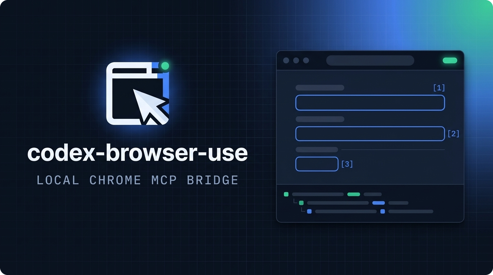
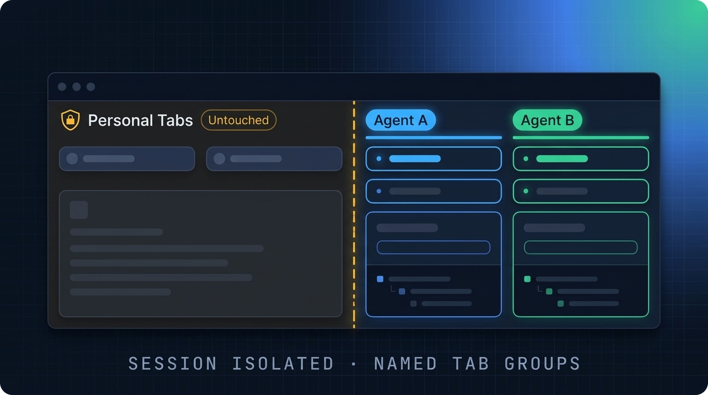

<div align="center">


# codex-browser-use

### One fast local MCP that gives any coding agent your real Chrome browser.

**Codex's Browser Use feature is so good — so I cloned it and made a faster, open-source version for every coding agent.**

[](LICENSE)
[](#quick-start)
[](#why-its-better)
[](#quick-start)
[](https://github.com/khanhle1406/codex-browser-use/stargazers)

[Quick start](#quick-start) · [How it works](#how-it-works) · [What you can do](#what-you-can-do) · [Why it's better](#why-its-better) · [FAQ](#faq) · [Documentation](#documentation)

<code>node mcp-server/bin/browser-use.js install --client antigravity --write --skill</code>

</div>

<div align="center">

<br />



</div>

---

Want your coding agent to open a website, click buttons, fill out forms, and test if your app actually works? Usually that means installing Playwright, launching a heavy extra browser, and burning through your token limit on giant HTML dumps and screenshots.

OpenAI Codex solved this cleanly by connecting straight to your real Chrome browser and reading pages as a short numbered list instead of raw HTML. The only catch is that it only works inside Codex. So I cloned the idea from scratch as a free, open-source tool that works with **any coding agent** — and tuned it to run even faster.

Setup takes one command. It installs a small Chrome extension, registers the local bridge, and sets up your agent automatically. Everything stays on your computer, and your personal Chrome tabs stay completely untouched.

## Quick start

You need **Node.js 26.12.1 or newer**, npm, and Chrome (or Chromium, Edge, or Brave).

### Set up your agent

Run these commands from the repo folder:

```sh
npm --prefix mcp-server ci
node mcp-server/bin/browser-use.js install --client antigravity --write --skill
node mcp-server/bin/browser-use.js doctor --json
```

`install` copies the Chrome extension (`v0.5.2`) to your home folder, hooks up Chrome's local bridge, adds the MCP server to your agent (saving a `.bak` backup first), and installs the matching instructions.

<details>
<summary><strong>Using Claude Code, Codex, Cursor, Windsurf, Copilot, Command Code, or OpenCode?</strong></summary>

Replace `--client antigravity` with your editor (`claude_code`, `cursor`, `windsurf`, `copilot`, or `commandcode`):

```sh
node mcp-server/bin/browser-use.js install --client cursor --write --skill
```

For Codex or OpenCode, print the config snippet and install the skill:

```sh
node mcp-server/bin/browser-use.js config --client codex
node mcp-server/bin/browser-use.js config --client opencode
node mcp-server/bin/browser-use.js install --client codex --skill
```

</details>

### Connect Chrome

1. Open `chrome://extensions`, turn on **Developer mode**, click **Load unpacked**, and choose `~/.local/share/browser-use/extension`.
2. Click the **Portable Browser Bridge** icon on Chrome's toolbar once so the green badge says `ON`.
3. Restart your coding agent so it loads all **36 tools**.

### Ask your agent

Once connected, just ask in plain English:

```text
Open http://127.0.0.1:3000 in a Chrome tab group called "App QA".
Test the signup form on desktop and mobile sizes, check for any console
or failed network errors, and leave the final tab open for me to check.
```

## How it works

### 1. Everything stays on your computer

Your agent talks to a local MCP server, which sends commands straight into your running Chrome browser through a lightweight extension. There is no cloud service, no Playwright browser download, and no hidden background server.


[Open the full-size figure](docs/assets/how-it-works-architecture.png).

### 2. One turn, tiny token usage, zero wasted waiting

Instead of taking one tiny step per AI message, your agent can run a whole multi-step flow (and even multiple tabs at once) in a single call. When reading a page, it gets a clean numbered list of buttons and inputs, and on the next step it only sees what changed — keeping token usage tiny.


[Open the full-size figure](docs/assets/how-it-works-workflow.png).

<details>
<summary><strong>Example: run two tabs in one call and group them in Chrome</strong></summary>

```json
{
  "name": "browser_run",
  "arguments": {
    "return_state": "none",
    "end_turn": true,
    "code": "await browser.nameSession('Docs Audit', 'cyan');\nconst [docsTab, pricingTab] = await Promise.all([\n  browser.tabs.new('https://example.com/docs'),\n  browser.tabs.new('https://example.com/pricing')\n]);\nconst outline = await docsTab.ariaSnapshot();\nconst plans = await pricingTab.locator('css=.plan-card').evaluateAll((els) => els.map((e) => e.dataset.tier));\nawait pricingTab.markDeliverable();\nreturn { outlineLines: outline.split('\\n').length, plans };"
  }
}
```

Or pass a simple list of steps (`goto`, `set_viewport`, `locator_fill`, `locator_click`, `wait`) to `browser_batch`.

</details>

### 3. Your personal tabs stay completely separate

The extension only touches tabs it opened for the current agent session. Your personal tabs, logins, and open windows are never visible to the agent. If multiple agents work at the same time, each one gets its own isolated tabs and its own colored Chrome Tab Group, and temporary tabs close automatically when the task finishes.



[Open the full-size figure](docs/assets/how-it-works-isolation.png).

## What you can do

| What you want to do | How it helps |
| --- | --- |
| **Test your web app** | Fill out forms, click buttons, test phone and desktop screen sizes, and catch page errors or broken API calls right after editing code. |
| **Check multiple pages at once** | Open several tabs side by side in a single turn, read clean page outlines, and pull out structured data safely. |
| **Click tricky UIs** | Works inside modern components, embedded iframes (like payment forms), file upload pickers, and file downloads. |
| **Keep Chrome neat** | Group an agent's tabs under a named, colored Chrome tab label while temporary tabs clean themselves up automatically. |
| **Handle logins & CAPTCHAs safely** | Never tries to bypass security checks — the agent pauses and leaves the tab open so you can sign in yourself. |

## Why it's better

| Feature | Playwright / Screenshot MCPs | Codex Built-in Browser Use | `codex-browser-use` |
| --- | :---: | :---: | :---: |
| Works with any coding agent | ✅ | ❌ Codex only | ✅ Any MCP agent |
| Uses your real Chrome (no extra browser) | ❌ Heavy extra browser | ✅ | ✅ |
| 100% open-source MIT (no closed binary) | ✅ | ❌ Closed runtime | ✅ Pure Node.js + MV3 |
| Multi-step scripts & parallel tabs in 1 call | ❌ One step per turn | ✅ | ✅ + `browser.tabs.new` |
| Short numbered outlines (not raw HTML) | ❌ Huge DOM / PNGs | ✅ | ✅ Only sends changes |
| Named Chrome Tab Groups | ❌ | ✅ | ✅ |
| Fast local speed without timer polling | ❌ Slow per-step wait | ✅ | ✅ Up to 6.8x faster in parallel |

Under the hood, commands run in parallel over the local bridge and wait directly on Chrome page events instead of polling on timers — making 4-tab parallel runs **6.83x faster** and full page + iframe + screenshot reads **~3x faster**.

<details>
<summary><strong>See full benchmark numbers &amp; run it yourself</strong></summary>

Measured on Node `v26.13.0` with [perf-benchmark.mjs](mcp-server/bench/perf-benchmark.mjs) using real local sockets, Native Messaging streams, and simulated page latencies held identical before vs. after optimization:

| What was measured | Before | After | Speedup |
| --- | --- | --- | --- |
| **4 Parallel Tabs** (`goto` + read page) | `606.79 ms` | **`88.86 ms`** | **6.83x faster** (`-85.4%`) |
| **Page + 4 Iframes + Screenshot** | `267.63 ms` / `226.38 ms` | **`90.88 ms`** / **`72.59 ms`** | **2.94x** cold / **3.12x** warm |
| **Wait for Page Load** (+ assets) | `130.54 ms` (`10` polls) | **`113.58 ms`** (**`0`** polls) | **Zero polling checks** |
| **Wait for Element & Text** (`90ms` delay) | `406.74 ms` (`8` checks) | **`289.37 ms`** (`3` checks) | **1.41x faster** / `-62.5%` calls |
| **Fill 10 Fields in a Row** | `399.85 ms` (`40` calls) | **`187.89 ms`** (`20` calls) | **2.13x faster** (half the calls) |
| **Click 10 Times Inside an Iframe** | `494.31 ms` (`51` calls) | **`151.28 ms`** (`15` calls) | **3.27x faster** (`-70.6%` calls) |
| **Extension Stream & 40 Large Replies** | `34.18 ms` / `120` msgs | **`26.57 ms`** / **`40` msgs** | `-22.3%` CPU / **`-66.7%` msgs** |
| **40 MB Over Local Socket** | `263.01 ms` (`152.1 MB/s`) | **`132.20 ms`** (**`302.6 MB/s`**) | **~2.0x throughput** |

Run the benchmark locally:

```sh
npm --prefix mcp-server run bench
```

</details>

<details>
<summary><strong>View all 36 MCP tools</strong></summary>

| Group | Tools |
| --- | --- |
| **Multi-step & Status** (`3`) | `browser_run`, `browser_batch`, `browser_status` |
| **Read & Debug** (`8`) | `browser_get_state`, `browser_screenshot`, `browser_get_content`, `browser_dom_snapshot`, `browser_inspect_element`, `browser_console_logs`, `browser_network_logs`, `browser_evaluate` |
| **Click, Type & Files** (`9`) | `browser_click`, `browser_set_value`, `browser_type_text`, `browser_press_key`, `browser_select_option`, `browser_hover`, `browser_drag`, `browser_scroll`, `browser_upload_files` |
| **Smart Locators, Waits & Screen Size** (`4`) | `browser_locator_click`, `browser_locator_fill`, `browser_wait_for`, `browser_set_viewport` |
| **Navigation, Tabs & Groups** (`9`) | `browser_goto`, `browser_back`, `browser_forward`, `browser_reload`, `browser_list_tabs`, `browser_new_tab`, `browser_select_tab`, `browser_close_tab`, `browser_name_session` |
| **Popups & Cleanup** (`3`) | `browser_handle_dialog`, `browser_end_turn`, `browser_reset` |

</details>

## FAQ

<details>
<summary><strong>Which coding agents work with this?</strong></summary>

Any agent that supports local MCP tools: Antigravity, Claude Code, Codex CLI, Cursor, Windsurf, GitHub Copilot CLI, Command Code, OpenCode, or custom setups.

</details>

<details>
<summary><strong>Can the agent see my personal tabs or saved passwords?</strong></summary>

No. The extension only accesses blank tabs it created for that agent session. Your personal tabs, bookmarks, and unrelated windows stay private. Read-only page checks (`browser_evaluate`) also block page edits, storage writes, and network calls.

</details>

<details>
<summary><strong>Why not just use Playwright MCP?</strong></summary>

Playwright installs heavy separate browsers, starts cold every time, and often sends large DOM dumps or full PNGs per action. `codex-browser-use` connects straight to your everyday Chrome with short page outlines, named Tab Groups, and 1-call scripts — nothing extra to download.

</details>

<details>
<summary><strong>What happens on login pages, 2FA, or CAPTCHAs?</strong></summary>

Agents are told never to bypass logins or CAPTCHAs. When a page needs you to sign in, the agent pauses (`handoff`) and asks you to complete it in Chrome yourself, then picks right back up.

</details>

<details>
<summary><strong>How do I update or check if everything is working?</strong></summary>

Pull the latest code, run `node mcp-server/bin/browser-use.js install --client <your-client> --skill`, click **Reload** on **Portable Browser Bridge** in `chrome://extensions`, and run `node mcp-server/bin/browser-use.js doctor --json`.

</details>

## Documentation

Run tests, lint, and health checks anytime:

```sh
npm --prefix mcp-server test
npm --prefix mcp-server run lint
npm --prefix mcp-server run bench
node mcp-server/bin/browser-use.js doctor --json
```

- [Agent Skill Instructions](skill/SKILL.md) — workflow guide installed for your coding agent
- [Browser Policy Rule](rules/browser_use.md) — safety and tool-usage rules
- [Compatibility & Engine Modes](docs/compatibility.md) — standalone setup details
- [Transport & IPC Notes](docs/transport-investigation.md) — how the local socket and native bridge work
- [Legacy v1 Notes](docs/legacy-v1.md) — older v1 architecture reference

## Contributing

Issues and pull requests are welcome at [khanhle1406/codex-browser-use](https://github.com/khanhle1406/codex-browser-use).

## License

[MIT](LICENSE)
