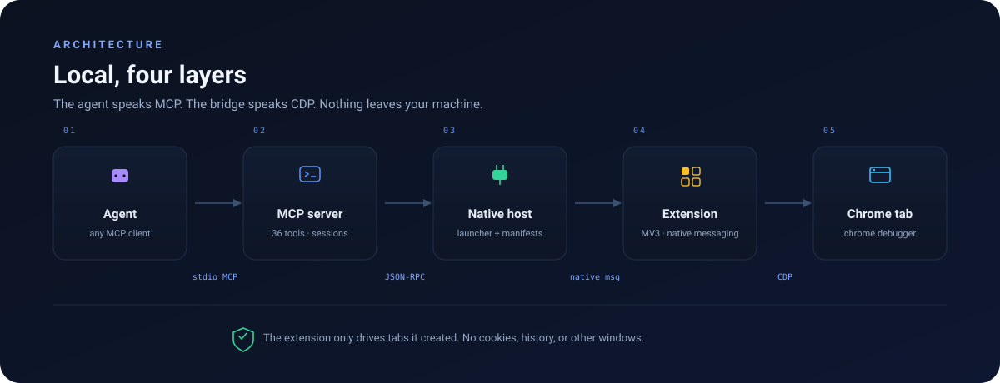

<div align="center">


# codex-browser-use

**Fast, token-efficient Chrome automation for any MCP coding agent.**

*Persistent 1-shot workflows, batch pipelines, diff-first accessibility trees, Shadow DOM & iframe locators — zero Playwright, zero proprietary engine.*

[](LICENSE)
[](#quick-start)
[-5B8DEF?style=flat-square)](#tools-36)
[](#quick-start)
[](#architecture)
[](https://github.com/khanhle1406/codex-browser-use/stargazers)

[Features](#features) · [Quick Start](#quick-start) · [Examples](#examples) · [Benchmarks](#benchmarks) · [Architecture](#architecture) · [Tools (36)](#tools-36) · [Safety](#safety-model) · [Documentation](#documentation)

</div>

<p align="center">
  
</p>

> [!NOTE]
> **100% standalone MIT core.** No proprietary runtime binary and no Playwright installation required. The MCP server drives your local Chrome-family browser directly over Chrome DevTools Protocol through a lightweight Native Messaging bridge and Chrome extension (`v0.5.2`), with strict per-session tab isolation.

---

## Features

- **Persistent 1-Shot `browser_run`**: Execute full multi-step JavaScript automation scripts in a single MCP tool call with persistent top-level bindings across turns, independent parallel `browser.tabs.new()` handles, named Chrome Tab Groups (`browser.nameSession()`), fluent auto-waiting locators (`.filter({ has, hasNot, hasNotText })`, `.and()`, `.or()`, `.check()`, `.evaluateAll()`), child-iframe-merged YAML `ariaSnapshot()`, read-only `evaluate(fn, arg)`, `waitForEvent("filechooser" | "download")`, `viewImage`, and inline `markDeliverable()` + `end_turn` cleanup.
- **One-Call `browser_batch` Pipelines**: Chain linear steps (`goto`, `locator_fill`, `locator_click`, `select_option`, `wait`, `set_viewport`, `name_session`) with automatic event-driven settling, optional inline `end_turn`, and final diff state in one round-trip.
- **Diff-First `<ax_state>` & 1x CSS-Scaled JPEG**: Redundant `StaticText` nodes under semantic controls are pruned cleanly, subsequent reads emit compact structural diffs (`+added`, `~changed`, `-removed` counts), default state reads skip images (`screenshot: false`), and Retina screenshots are downscaled `1 / devicePixelRatio` to fast JPEG (`quality: 80`).
- **Full Locator Engine**: Supports CSS, `text=`, `role=…[name=…]`, `label=`, `placeholder=`, `testid=`, chained `>>` pipelines (`first`, `last`, `nth=`, `visible=true`, `has=`, `has-not=`, `has-text=`, `has-not-text=`), `and=`/`or=`, open Shadow DOM piercing, and both same-origin and cross-origin out-of-process iframes (OOPIFs).
- **High-Throughput Local IPC Engine (`v4.5.1`)**: Bounded concurrent Unix socket dispatch (`32` max in-flight RPCs, zero head-of-line blocking with turn barriers), parallel CDP domain initialization, concurrent child-iframe AX collection + Retina screenshot capture, event-driven navigation waits (`0` `readyState` polls), in-page `MutationObserver` waiting, `navRevision`-keyed iframe route caching, O(n) zero-copy `FrameReader`, lazy zero-buffer `Network.enable`, and `512 KB` extension chunking.
- **Works With Any MCP Coding Agent**: Built for Antigravity, Claude Code, Codex CLI, Cursor, Windsurf, GitHub Copilot CLI, Command Code, OpenCode, or any stdio MCP client.

---

## Quick Start

**Requirements:** Node.js **26.12.1 or newer**, npm, and Google Chrome, Chromium, Microsoft Edge, or Brave.

### 1. Install Dependencies, Extension & Client Config

From the repository root:

```sh
npm --prefix mcp-server ci
node mcp-server/bin/browser-use.js install --client antigravity --write --skill
node mcp-server/bin/browser-use.js doctor --json
```

`install` copies the bundled Chrome extension (`v0.5.2` with 16/32/48/128 toolbar icons) to `~/.local/share/browser-use/extension`, registers the Chrome Native Messaging host manifest, merges the MCP server config (with `.bak` backup), and installs [skill/SKILL.md](skill/SKILL.md).

<details>
<summary><strong>Supported clients & TOML / JSONC manual config</strong></summary>

| Client Flag (`--client`) | Auto `--write` Config Target | `--skill` Install Target |
| --- | --- | --- |
| `antigravity` (`agy`) | `~/.gemini/config/mcp_config.json` (eager core tools enabled) | `~/.gemini/config/skills/codex-browser-use/SKILL.md` |
| `claude_code` (`claude`) | `~/.claude.json` | `~/.claude/skills/codex-browser-use/SKILL.md` |
| `cursor` | `~/.cursor/mcp.json` | `~/.cursor/skills/codex-browser-use/SKILL.md` |
| `windsurf` | `~/.codeium/windsurf/mcp_config.json` | `~/.codeium/windsurf/skills/codex-browser-use/SKILL.md` |
| `copilot` (`github-copilot`) | `~/.copilot/mcp-config.json` | `~/.agents/skills/codex-browser-use/SKILL.md` |
| `commandcode` | `~/.commandcode/mcp.json` | `~/.agents/skills/codex-browser-use/SKILL.md` |
| `codex` | Print TOML snippet via `config` | `~/.codex/skills/codex-browser-use/SKILL.md` |
| `opencode` | Print JSONC snippet via `config` | `~/.agents/skills/codex-browser-use/SKILL.md` |

Print mergeable snippets for Codex or OpenCode:

```sh
node mcp-server/bin/browser-use.js config --client codex
node mcp-server/bin/browser-use.js config --client opencode
node mcp-server/bin/browser-use.js install --client codex --skill
```

</details>

### 2. Load & Connect the Chrome Extension

1. Open `chrome://extensions` in Chrome and enable **Developer mode**.
2. Click **Load unpacked** and select `~/.local/share/browser-use/extension` (or click **Reload** when upgrading to `0.5.2`).
3. Click the **Portable Browser Bridge** icon on Chrome's toolbar once so the badge reads `ON` (this publishes the live socket descriptor to `~/.local/share/browser-use/chrome-host/bridge.json`).
4. Restart your MCP client / agent session to load all **36 tools**.

---

## Examples

### 1-Shot Multi-Tab Workflow with Named Tab Group (`browser_run`)

```json
{
  "name": "browser_run",
  "arguments": {
    "return_state": "none",
    "end_turn": true,
    "code": "await browser.nameSession('Docs Audit', 'cyan');\nconst [docsTab, pricingTab] = await Promise.all([\n  browser.tabs.new('https://example.com/docs'),\n  browser.tabs.new('https://example.com/pricing')\n]);\nconst aria = await docsTab.ariaSnapshot();\nconst tiers = await pricingTab.locator('css=.tier-card').evaluateAll((els) => els.map((e) => e.dataset.tier));\nawait pricingTab.markDeliverable();\nreturn { ariaLines: aria.split('\\n').length, tiers };"
  }
}
```

### Responsive Audit + Form Flow (`browser_batch`)

```json
{
  "name": "browser_batch",
  "arguments": {
    "return_state": "diff",
    "end_turn": true,
    "keep": "handoff",
    "steps": [
      { "action": "name_session", "name": "Checkout QA", "color": "green" },
      { "action": "goto", "url": "https://example.com/signup" },
      { "action": "set_viewport", "width": 390, "height": 844, "device_scale_factor": 2, "mobile": true },
      { "action": "locator_fill", "selector": "label=Email", "text": "ada@example.com" },
      { "action": "locator_click", "selector": "role=button[name='Continue']" },
      { "action": "wait", "text": "Verify your inbox" }
    ]
  }
}
```

---

## Benchmarks

Reproducible harness in [perf-benchmark.mjs](mcp-server/bench/perf-benchmark.mjs) measured on **Node `v26.13.0`** over real Unix domain sockets, Native Messaging `PassThrough` streams running `extension/background.js`, and a DOM VM with live `MutationObserver` (holding simulated CDP latencies constant before vs. after optimization):

| Scenario | Before (`v4.5.0`) | After (`v4.5.1`) | Improvement |
| --- | --- | --- | --- |
| **Multi-Tab Parallel** (`4` tabs `goto` + `getState`) | `606.79 ms` (`68` RPCs) | **`88.86 ms`** (`60` RPCs) | **6.83x faster** (`-85.4%`) |
| **`getState` + `4` Child Iframes + Retina Screenshot** | Cold `267.63 ms` / Warm `226.38 ms` | Cold **`90.88 ms`** / Warm **`72.59 ms`** | **2.94x** cold / **3.12x** warm |
| **`goto(..., waitUntil: "load")`** (+ 8 subresources) | `130.54 ms` (`10` eval polls, `Network` on) | **`113.58 ms`** (**`0`** eval polls, lazy `Network`) | `-13.0%` latency / **`-100%` polls** |
| **`goto(..., waitUntil: "networkidle")`** | `474.30 ms` (`14` eval polls) | `467.91 ms` (**`0`** eval polls) | **Zero `readyState` polling** |
| **DOM `MutationObserver` Wait** (`selector`, `text`, `click` @90ms) | `406.74 ms` (`8` evals) | **`289.37 ms`** (`3` evals) | **1.41x faster** / `-62.5%` IPC calls |
| **`setValue` Sequential** (`10` calls) | `399.85 ms` (`40` CDPs) | **`187.89 ms`** (`20` CDPs) | **2.13x faster** (`50%` fewer CDPs) |
| **Cross-Origin Iframe Cached Route** (`10` clicks) | `494.31 ms` (`51` CDPs) | **`151.28 ms`** (`15` CDPs) | **3.27x faster** (`-70.6%` CDPs) |
| **Extension Stream + `40 x 350 KB` Replies** | `34.18 ms` events / `120` wire msgs | **`26.57 ms`** events / **`40`** wire msgs | `-22.3%` event CPU / **`-66.7%` wire msgs** |
| **Fragmented `1 MB` Frames Over Unix Socket (`40 MB`)** | `263.01 ms` (`152.1 MB/s`) | **`132.20 ms`** (**`302.6 MB/s`**) | **~2.0x throughput** (`-49.7%`) |

Run the benchmark locally:

```sh
npm --prefix mcp-server run bench
```

---

## Architecture

<p align="center">
  
</p>

| Component | Path | Responsibility |
| --- | --- | --- |
| **MCP Server & Tool Surface** | [server.js](mcp-server/src/server.js) | Exposes all 36 MCP tools (`v4.5.0`), batch execution, state modes, and lifecycle controls |
| **Persistent Script Runner** | [script-runner.js](mcp-server/src/script-runner.js) | Stateful async `vm` context, bound multi-tab handles, `ax.write` diffing, and `viewImage` |
| **CDP Client & Event State** | [bridge-browser.js](mcp-server/src/bridge-browser.js) | Parallel domain/frame/screenshot orchestration, event-driven navigation, route cache, CSS JPEG scaling |
| **AX Tree & Diff Engine** | [ax-tree.js](mcp-server/src/ax-tree.js) | Prunes redundant `StaticText`, merges child iframes, renders ARIA YAML & compact structural diffs |
| **In-Page Locator Engine** | [locators.js](mcp-server/src/locators.js) | Deep Shadow DOM & iframe resolution, `MutationObserver` waits, hit-testing, semantic setters |
| **Unix Socket & O(n) Framing** | [backend-transport.js](mcp-server/src/backend-transport.js), [frame-reader.js](mcp-server/src/frame-reader.js), [bridge-client.js](mcp-server/src/bridge-client.js) | Zero-copy `FrameReader`, single-alloc `encodeFrame`, concurrent dispatch (`32` slots) with turn barriers |
| **Native Driver & Session Store** | [backend-native-driver.js](mcp-server/src/backend-native-driver.js), [backend-tabs.js](mcp-server/src/backend-tabs.js), [backend-page-commands.js](mcp-server/src/backend-page-commands.js) | Per-session tab/group isolation, per-tab timeout isolation, strict CDP command allowlist |
| **Chrome MV3 Extension** | [background.js](mcp-server/extension/background.js), [manifest.json](mcp-server/extension/manifest.json) | Manages owned session tabs, Chrome Tab Groups (`tabGroups`), `downloads`, CDP forwarding, `512 KB` chunking |

---

## Tools (36)

| Category | Tools | Purpose |
| --- | --- | --- |
| **1-Shot, Batch & Status** (`3`) | `browser_run`, `browser_batch`, `browser_status` | Stateful async automation scripts, multi-step linear pipelines, bridge diagnostics |
| **Observe & Diagnostics** (`8`) | `browser_get_state`, `browser_screenshot`, `browser_get_content`, `browser_dom_snapshot`, `browser_inspect_element`, `browser_console_logs`, `browser_network_logs`, `browser_evaluate` | Diff-first `<ax_state>`, CSS-scaled JPEG/PNG, DOM/ARIA snapshots, coordinate locators, logs, AST-guarded read-only JS |
| **Index & Coordinate Actions** (`9`) | `browser_click`, `browser_set_value`, `browser_type_text`, `browser_press_key`, `browser_select_option`, `browser_hover`, `browser_drag`, `browser_scroll`, `browser_upload_files` | Hit-tested index or `(x, y)` actions, semantic value setting, native `<select>`, wheel scroll, file input uploads |
| **Locators, Waits & Viewport** (`4`) | `browser_locator_click`, `browser_locator_fill`, `browser_wait_for`, `browser_set_viewport` | Shadow DOM & iframe auto-waiting locators, `MutationObserver`/URL/load waits, responsive viewport emulation |
| **Navigate, Tabs & Groups** (`9`) | `browser_goto`, `browser_back`, `browser_forward`, `browser_reload`, `browser_list_tabs`, `browser_new_tab`, `browser_select_tab`, `browser_close_tab`, `browser_name_session` | Isolated tab creation/switching, navigation with diff state, Chrome Tab Group title & color |
| **Dialogs & Turn Lifecycle** (`3`) | `browser_handle_dialog`, `browser_end_turn`, `browser_reset` | `alert`/`confirm`/`prompt`/`beforeunload` responses, `handoff`/`deliverable` tab retention, clean VM & browser reset |

---

## Safety Model

- **AST-Validated Read-Only Evaluation**: `browser_evaluate` and `tab.evaluate()` parse code via `acorn` ([read-only.js](mcp-server/src/read-only.js)) and reject assignments, mutations, `delete`, DOM/style/`classList`/`dataset` writes, storage/history writes, dynamic code evaluation, and network requests while permitting non-mutating DOM/style inspection.
- **Session & Tab Isolation**: The extension maintains an explicit `owned` set of tabs created within each MCP connection and validates ownership on CDP execution, downloads, and `tabGroups`. Existing user tabs, cookies, and windows remain untouched.
- **Strict CDP & URL Allowlist**: [backend-page-commands.js](mcp-server/src/backend-page-commands.js) permits only reviewed page-scoped CDP methods, requires absolute paths on `DOM.setFileInputFiles`, and rejects credentialed or `javascript:` URLs on navigation.
- **Human-in-the-Loop Auth & CAPTCHA**: Never bypasses logins, permission prompts, or CAPTCHAs — agents retain the live tab via `handoff` so you can interact directly in Chrome.

---

## Development

```sh
node --check mcp-server/extension/background.js
npm --prefix mcp-server test
npm --prefix mcp-server run lint
npm --prefix mcp-server run bench
node mcp-server/bin/browser-use.js doctor --json
```

---

## Documentation

- **Agent Skill Definition**: [skill/SKILL.md](skill/SKILL.md)
- **Always-On Policy Rule**: [rules/browser_use.md](rules/browser_use.md)
- **Compatibility & Engine Modes**: [docs/compatibility.md](docs/compatibility.md)
- **IPC & Transport Notes**: [docs/transport-investigation.md](docs/transport-investigation.md)
- **Legacy v1 Reference**: [docs/legacy-v1.md](docs/legacy-v1.md)
- **License**: [MIT](LICENSE)
