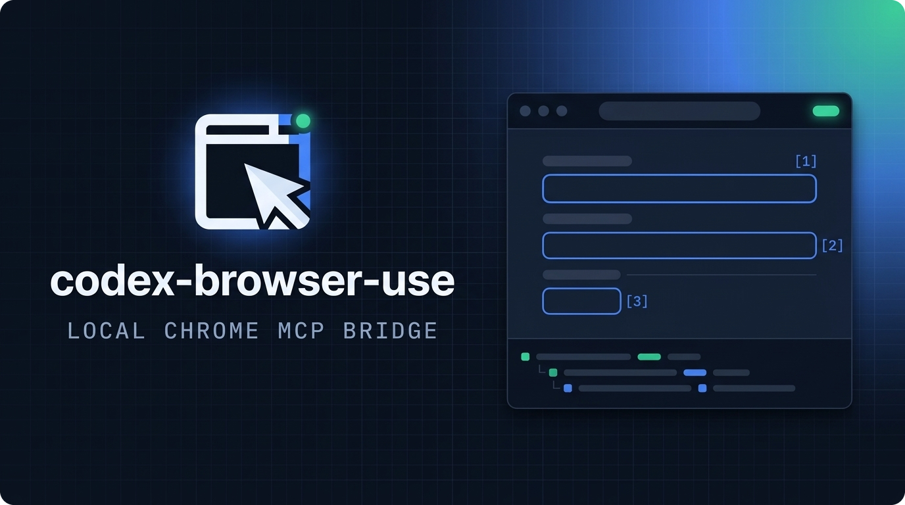
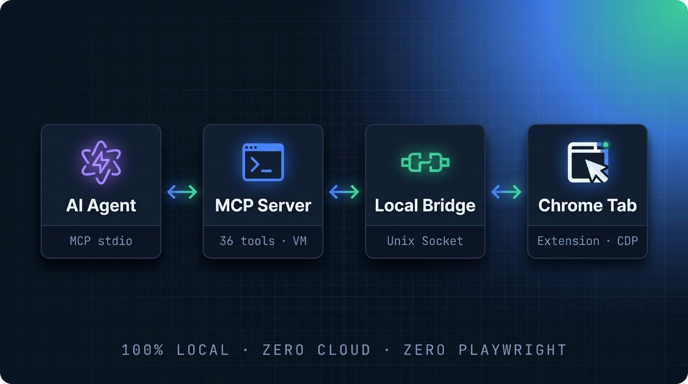
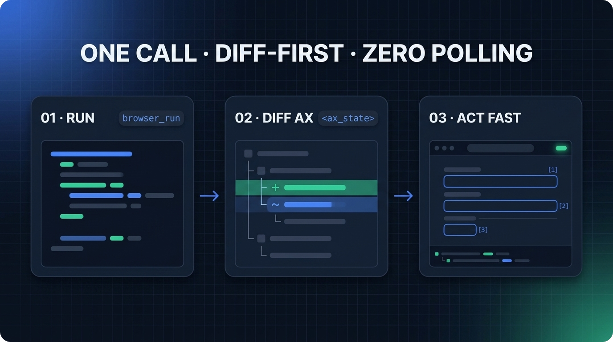
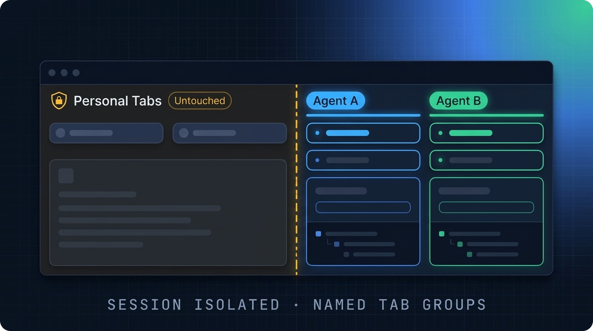

<div align="center">


# codex-browser-use

### 普段使いのリアルな Chrome をあらゆる AI コーディングエージェントから操れる超高速ローカル MCP。

**Codex の Browser Use 機能があまりに優秀だったので、ゼロからオープンソースで再現し、全エージェント向けにさらに高速化しました。**

[English](../../README.md) · [Tiếng Việt](README_vi.md) · [简体中文](README_zh-CN.md) · **日本語** · [한국어](README_ko.md)

[](../../LICENSE)
[](https://codex-browser-use.vercel.app)
[](#クイックスタート)
[](#選ばれる理由)
[](#クイックスタート)
[](https://github.com/khanhle1406/codex-browser-use/stargazers)

[Webサイト](https://codex-browser-use.vercel.app) · [クイックスタート](#クイックスタート) · [仕組み](#仕組み) · [できること](#できること) · [選ばれる理由](#選ばれる理由) · [FAQ](#faq) · [ドキュメント](#ドキュメント)

<code>node mcp-server/bin/browser-use.js install --client antigravity --write --skill</code>

</div>

<div align="center">

<br />



</div>

---

コーディングエージェントに Web サイトを開かせ、ボタンをクリックし、フォームに入力して実際にアプリが動くかテストさせたいと思いませんか？これまでの定番では Playwright を導入し、重い別ブラウザを起動したうえで、巨大な HTML ダンプとスクリーンショットでトークン上限をあっという間に使い果たしていました。

OpenAI Codex はこの課題をエレガントに解決しました。実行中の普段使いの Chrome に直接接続し、生の HTML ではなく短い番号付きリストとしてページを読み取ります。唯一の制約は Codex 内部でしか使えないことでした。そこで同じ仕組みをゼロから**完全オープンソース（MIT）**として実装し、**あらゆるコーディングエージェント**でさらに高速に動作するようチューニングしました。

セットアップはコマンド 1 行で完了します。軽量な Chrome 拡張の配置、ローカルブリッジの登録、そしてエージェント用スキル一式と常時適用ルールを自動で導入します。エージェントは現在開いている Chrome の中で動作するため、既存の Cookie やログイン状態を維持したまま、あなたの個人タブや作業中の画面には一切触れません。

## クイックスタート

必要な環境：**Node.js 26.12.1 以上**、npm、および Chrome（または Chromium、Edge、Brave）。

### エージェントをセットアップする

リポジトリのルートディレクトリで以下のコマンドを実行します（npm 公開後は `npx -y codex-browser-use ...` でも実行可能）：

```sh
npm --prefix mcp-server ci
node mcp-server/bin/browser-use.js install --client antigravity --write --skill
node mcp-server/bin/browser-use.js doctor --json
```

`install --skill` は Chrome 拡張（`v0.6.4`）のコピー、ローカル Chrome Native Messaging ホストの登録、クライアントへの MCP 設定追記（先に `.bak` バックアップを保存）、スキル一式（`skill/SKILL.md` + `skill/references/cookbook.md` + `skill/references/tools.md`）の導入、さらに対応クライアントでは常時適用ルール（`rules/browser_use.md`、Cursor の場合は `.cursor/rules/browser_use.mdc`）のインストールを自動で行います（`--no-rules` で省略、`--rules` 単体指定も可）。

<details>
<summary><strong>対応クライアントとツールプロファイル (<code>--profile auto | compact | standard | full</code>)</strong></summary>

| クライアント | MCP 設定ファイル | スキル格納先 | `--skill` で導入されるルール |
| --- | --- | --- | --- |
| `antigravity` | `~/.gemini/config/mcp_config.json` | `~/.gemini/config/skills/codex-browser-use/` | `~/.gemini/config/rules/browser_use.md` |
| `commandcode` | `~/.commandcode/mcp.json` | `~/.agents/skills/codex-browser-use/` | `~/.agents/rules/browser_use.md` *(`--profile compact` または `auto` 推奨)* |
| `cursor` | `~/.cursor/mcp.json` | `~/.cursor/skills/codex-browser-use/` | `~/.cursor/rules/browser_use.mdc` *(Cursor 用 frontmatter 付き)* |
| `windsurf` | `~/.codeium/windsurf/mcp_config.json` | `~/.codeium/windsurf/skills/codex-browser-use/` | `~/.codeium/windsurf/rules/browser_use.md` |
| `copilot` | `~/.copilot/mcp-config.json` | `~/.agents/skills/codex-browser-use/` | `~/.agents/rules/browser_use.md` |
| `claude_code` | `~/.claude.json` | `~/.claude/skills/codex-browser-use/` | *(スキップ)* |
| `codex` | `config` で TOML を出力 | `~/.codex/skills/codex-browser-use/` | *(スキップ)* |
| `opencode` / `generic` | `config` で設定を出力 | `~/.agents/skills/codex-browser-use/` | `~/.agents/rules/browser_use.md` |

ツール遅延読み込み非対応の CLI クライアント（Codex、Claude Code、Command Code、Copilot、OpenCode）では `--profile auto`（CLI には `"compact"`、遅延読み込み IDE には `"full"` を自動選択）または `--profile compact` / `BROWSER_USE_TOOL_PROFILE=compact` を指定してください。コア 7 ツールのみを登録し、固定ツールスキーマ容量を **75.4%** 削減します（`30,302` バイト / 推定 `~7,576` トークン → `7,457` バイト / 推定 `~1,865` トークン）：

```sh
node mcp-server/bin/browser-use.js install --client commandcode --write --skill --profile auto
node mcp-server/bin/browser-use.js config --client codex --profile auto
```

Codex や OpenCode の場合は設定スニペットを表示してスキルをインストールします：

```sh
node mcp-server/bin/browser-use.js config --client codex
node mcp-server/bin/browser-use.js config --client opencode
node mcp-server/bin/browser-use.js install --client codex --skill
```

</details>

### Chrome と接続する

1. `chrome://extensions` を開き、右上の **デベロッパー モード（Developer mode）** をオンにし、**パッケージ化されていない拡張機能を読み込む（Load unpacked）** から `~/.local/share/browser-use/extension` を選択します。
2. これで完了です — **Portable Browser Bridge** がバックグラウンドで自動接続します（アイコンにカーソルを合わせて状態確認、クリックで一時停止／再接続）。
3. コーディングエージェントを再起動して MCP ツールを読み込ませてください。

### エージェントに指示を出す

接続できたら、普段どおり自然言語で話しかけるだけです：

```text
Open http://127.0.0.1:3000 in a Chrome tab group called "App QA".
Test the signup form on desktop and mobile sizes, check for any console
or failed network errors, save an element screenshot of the signup card,
and leave the final tab open for me to check.
```

## 仕組み

### 1. すべてがあなたの PC 内で完結

エージェントはローカルの MCP サーバー（`v4.8.1`）と通信し、軽量な Chrome 拡張機能（`v0.6.4`）を経由して実行中の Chrome に直接コマンドを送信します。クラウドサービスも、Playwright 用ブラウザのダウンロードも、外部公開サーバーも一切ありません。



### 2. 1 ターン実行・極小トークン・ポーリング待機ゼロ

小さな操作のたびに AI メッセージを消費する代わりに、`browser_run` 1 回の呼び出しで複数ステップの一連の処理（最大 `300,000` ms / `5` 分）を実行でき、最大 `10` 個の URL を並列処理できます（`browser.tabs.content()`）。スナップショットは `browser_run`、`browser_batch`、`ariaSnapshot()` すべてで既定 `mode: "compact"`（`"full"` / `"interactive"` も利用可）となり、`ariaSnapshot()` と `getState()` 間で統一された AX 差分ベースラインを共有します。さらに部分サブツリー取得 `locator.ariaSnapshot()`（ダイアログやカード単体の読み取り）、構造化エクスポート（`browser_get_content` および `page.content.export()` / `.tables()` / `.links()`）、CSS スケーリングされたスクリーンショット（既定 `max_width` `1280` px、JPEG 品質 `75`）、差分更新によりトークン消費を最小限に抑えます。

`v4.7.0`–`v4.8.1` では、`browser_run` にコンテキストを膨らませないローカルファイル操作ヘルパー（`saveFile`、`readFile`、`emit: true` 対応 `saveScreenshot`、`nodeRepl` エイリアス・`saved_files` メタデータ自動通知）、余白ゼロで要素を切り抜く `locator.screenshot()` / `page.elementScreenshot()`、`tab.ax.paste()` / `tab.ax.selectText()`、`page.innerText()` / `page.textContent()` / `page.check()` 短縮記法、ローカル `{}`/`[]` 生成を許容する読み取り専用 `evaluate()`、`tab.dev.enableNetwork({ captureBodies: true })` + `tab.dev.responseBody(requestId)` によるレスポンスボディ取得、タブグループ統合、および `--profile auto` を追加しました。



<details>
<summary><strong>実行例：複数 URL 並列抽出・ファイル保存・要素スクリーンショット証跡の同時実行</strong></summary>

```json
{
  "name": "browser_run",
  "arguments": {
    "return_state": "none",
    "end_turn": true,
    "code": "await browser.nameSession('Docs Audit', 'cyan');\nconst pages = await browser.tabs.content([\n  'https://example.com/docs',\n  'https://example.com/pricing'\n], { format: 'markdown', concurrency: 2 });\nconst saved = await saveFile('/abs/path/docs-export.json', pages);\nconst pricingTab = await browser.tabs.new('https://example.com/pricing');\nawait pricingTab.locator('css=.plan-card').first().saveScreenshot('/abs/path/plan-card.png', { padding: 12, emit: true });\nawait pricingTab.markDeliverable();\nreturn { extracted: pages.length, file: saved.path };"
  }
}
```

また、決まった手順リスト（`goto`、`set_viewport`、`locator_fill`、`locator_click`、`wait`、`get_state`、`get_content`、`read_tab`、`evaluate`）を `browser_batch` にまとめて渡すこともできます。

</details>

### 3. 既存タブも専用タブも自在に操作 —— 非ブロッキング仮想カーソル付き

エージェントは名前と色付きの専用 Chrome タブグループ内に新規タブを開き（`target="_blank"` ポップアップも自動捕捉し `page.waitForEvent("popup")` で待機可能）、Chrome デバッガーを接続せずに開いているユーザータブを受動的に読み取り（`browser.tabs.read(id)` / `browser.user.getTabContext(id)` および `chrome.scripting.executeScript` 経由の受動 `browser_get_content`）、または条件に一致する既存タブだけを選択して操作します。作業中は仮想カーソルとタブバッジがクリックや入力位置を視覚化します（`BROWSER_USE_CURSOR_MODE=fast|smooth|off`、既定の `fast` はブロック遅延 `0` ms）。タスク完了後は一時タブを自動クローズし、個人タブは安全にそのまま残します。



## できること

| やりたいこと | どう役立つか |
| --- | --- |
| **Web アプリのテスト** | フォーム入力（CKEditor 4/5・TinyMCE・Quill・`contenteditable`・`ax.paste`/`ax.selectText` 対応）、PC／モバイル画面幅切替、要素スクリーンショット（`locator.screenshot()`）、コンソールエラーや API レスポンスボディ（`dev.responseBody()`）の確認。 |
| **複数ページの抽出と巡回** | 最大 `10` URL の並列取得（`browser.tabs.content()`）、最大 5 分（`300s`）のページネーション処理、大容量データの `saveFile()` ディスク書き出しによるチャット欄保護、`page.assets.list()` や WebMCP ツール（`page.webmcp`）の読み取り。 |
| **複雑な UI の操作** | Shadow DOM、同一／クロスオリジン iframe（OOPIFs）、ファイル選択アップロード、長時間ファイルダウンロードに対応し、`not_found` タイムアウト時は最も近いロケーター候補を提案。 |
| **Chrome を整理された状態に保つ** | エージェントのタブを色・ラベル付きの Chrome タブグループにまとめ、終了時に一時タブを自動片付け。 |
| **ログインと CAPTCHA の安全な扱い** | セキュリティチェックのバイパスは行いません。認証が必要な画面では `handoff` で一時停止し、ユーザー自身のログイン完了を待ちます。 |

## 選ばれる理由

| 機能 | Playwright / スクリーンショット MCP | Codex 内蔵 Browser Use | `codex-browser-use` |
| --- | :---: | :---: | :---: |
| あらゆるコーディングエージェントに対応 | ✅ | ❌ Codex 専用 | ✅ 全 MCP エージェント対応 |
| 実 Chrome を使用（別ブラウザ不要） | ❌ 重い追加ブラウザ | ✅ | ✅ |
| 100% MIT オープンソース（クローズドバイナリなし） | ✅ | ❌ 非公開ランタイム | ✅ 純 Node.js + MV3 |
| 1 コールでの複数ステップ＆並列タブ実行 | ❌ 1 ターン 1 操作 | ✅ | ✅ + `tabs.new` & `tabs.content` |
| 短い番号付き概要 + ローカル `saveFile` | ❌ 巨大 DOM / PNG | ✅ | ✅ Diff 優先 + `mode` 圧縮 |
| 名前付き Chrome タブグループ | ❌ | ✅ | ✅ |
| タイマーポーリング不要の高速ローカル動作 | ❌ ステップ毎の待機が遅い | ✅ | ✅ 並列時最大 6.83x 高速 |

内部構造として、コマンドはローカルソケット越しに並列実行され、タイマーによる定期ポーリングではなく Chrome のページイベントを直接待機します。これにより 4 タブ並列処理は **6.83 倍高速**、ページ + iframe + スクリーンショット一括読み取りは **約 3 倍高速** になりました。`v4.6.0`–`v4.8.1` を通じて、ページ内永続ロケーターキャッシュ（`globalThis.__buRt` v2）は 10 回連続呼び出しのペイロードを `379,520` B から `1,260` B へ **99.7% 削減**、`compact` AX スナップショットは **81.7% 圧縮**（`3,812` → `699` 文字）、`markdown` 抽出は生テキスト比 **94.1% 圧縮**（`1,524` → `90` 文字）、`--profile compact` は MCP スキーマを **75.4% 削減**しています。実 Chrome 環境での同一モデル比較ベンチマーク（`gpt-6.1-terra`, medium）では、`codex-browser-use`（`--profile compact`）が 4 タスクすべてを Codex 内蔵プラグイン比 **28.8% 高速**（`55.79s` vs `78.38s`）、ブラウザ実行時間 **3.80 倍高速**（`3.48s` vs `13.21s`）、総入力トークン **51.9% 削減**（`305,934` vs `636,008`）で完了しました。

<details>
<summary><strong>全ベンチマーク結果を見る &amp; 手元で再現実行する</strong></summary>

#### 同一モデル Live エージェントベンチマーク（`gpt-6.1-terra medium`, 実 Chrome）

決定論的な 4 タスク Chrome ポータル（2 ページにわたるモーダル抽出、Shadow DOM + `contenteditable` フォーム送信、要素スクリーンショット証跡提出、トークン監査 — 両者とも **100/100** 満点）に対し [agent-benchmark.mjs](../../mcp-server/bench/agent-benchmark.mjs) で E2E 計測：

| 評価項目 | Codex 内蔵 Chrome プラグイン（`node_repl:js`） | `codex-browser-use`（`--profile compact`） | 実測改善幅 |
| --- | ---: | ---: | --- |
| **正答スコア** | `100 / 100` | **`100 / 100`** | 同等精度（モーダル `8/8`、送信 `1`） |
| **総実行時間（Wall-Clock）** | `78.38s` (`78,380 ms`) | **`55.79s`** (`55,792 ms`) | **28.8% 高速化** (`-22.59s`) |
| **初回ブラウザ操作まで（TTFA）** | `28.65s` (`28,646 ms`) | **`12.86s`** (`12,860 ms`) | **55.1% 高速化** |
| **ブラウザ実処理時間** | `13.21s` (`13,207 ms`) | **`3.48s`** (`3,476 ms`) | **3.80 倍高速化** (`-73.7%`) |
| **ブラウザツール呼び出し数** | `12` | **`8`** | **33.3% 回数削減** |
| **総入力トークン（キャッシュ含）** | `636,008` | **`305,934`** | **51.9% トークン削減** |
| **非キャッシュ入力トークン** | `52,584` | **`20,494`** | **61.0% トークン削減** |

実 Chrome 上でのライブベンチマーク実行（`same-model`、`head-to-head`、または `all`）：

```sh
npm --prefix mcp-server run bench:agents -- --mode same-model
```

#### コア IPC &amp; ペイロード マイクロベンチマーク

Node `v26.13.0` 上で実ローカルソケット・Native Messaging ストリーム・インメモリ MCP トランスポート・同一擬似ページ遅延条件のもと [perf-benchmark.mjs](../../mcp-server/bench/perf-benchmark.mjs) により計測：

| 計測項目 | 最適化前 / ベースライン | 最適化後 | 実測改善 |
| --- | --- | --- | --- |
| **4 タブ並列**（`goto` + ページ読取） | `606.79 ms` | **`88.86 ms`** | **6.83 倍高速** (`-85.4%`) |
| **ページ + 4 Iframe + スクショ** | `267.63 ms` / `226.38 ms` | **`90.88 ms`** / **`72.59 ms`** | **2.94 倍**（冷）/ **3.12 倍**（温） |
| **ページ読込完了待機**（+ アセット） | `130.54 ms`（`10` 回ポーリング） | **`113.58 ms`**（**`0`** 回） | **ポーリング完全ゼロ化** |
| **要素とテキスト出現待機**（`90ms` 遅延） | `406.74 ms`（`8` 回確認） | **`289.37 ms`**（`3` 回確認） | **1.41 倍高速** / `-62.5%` 呼び出し |
| **10 フィールド連続入力** | `399.85 ms`（`40` 回呼出） | **`187.89 ms`**（`20` 回呼出） | **2.13 倍高速**（呼出半減） |
| **Iframe 内 10 回連続クリック** | `494.31 ms`（`51` 回呼出） | **`151.28 ms`**（`15` 回呼出） | **3.27 倍高速**（`-70.6%` 呼出） |
| **拡張ストリーム & 大容量 40 応答** | `34.18 ms` / `120` メッセージ | **`26.57 ms`** / **`40` メッセージ** | CPU `-22.3%` / **メッセージ `-66.7%`** |
| **ローカルソケット 40 MB 転送** | `263.01 ms` (`152.1 MB/s`) | **`132.20 ms`** (**`302.6 MB/s`**) | **スループット約 2.0 倍** |
| **Locator ランタイムキャッシュ（`10` 回）** | `379,520 B` (`2.73 ms`) | **`1,260 B`** (**`1.13 ms`**) | **ペイロード 99.7% 削減** |
| **MCP ツールスキーマ（`compact` vs `full`）** | `30,302 B`（`~7,576` tok, `36` 個） | **`7,457 B`**（**`~1,865` tok, `7` 個**） | **スキーマ 75.4% 削減** |
| **AX `compact` & Markdown コンテンツ** | `3,812` AX / `1,524` 文字 | **`699`** AX / **`90`** 文字 | **81.7%** AX / **94.1%** テキスト節約 |

手元でのベンチマーク実行：

```sh
npm --prefix mcp-server run bench
```

</details>

<details>
<summary><strong>全 36 MCP ツールとプロファイル一覧 (compact / standard / full)</strong></summary>

`--profile compact|standard|full`（または環境変数 `BROWSER_USE_TOOL_PROFILE`）で切り替えます：**`compact`** は主要 7 ツールのみ登録（`browser_run`、`browser_batch`、`browser_get_state`、`browser_goto`、`browser_list_tabs`、`browser_screenshot`、`browser_end_turn` — 固定スキーマを `30,302 B` / `~7,576` トークンから `7,457 B` / `~1,865` トークンへ `75.4%` 削減）；**`standard`** は 14 ツール（`~3,023` トークン）；**`full`**（全 36 ツール）は遅延読み込み対応 IDE の既定値です。

| カテゴリ | ツール名 |
| --- | --- |
| **マルチステップ & 状態** (`3`) | `browser_run`, `browser_batch`, `browser_status` |
| **読み取り & デバッグ** (`8`) | `browser_get_state`, `browser_screenshot`, `browser_get_content`, `browser_dom_snapshot`, `browser_inspect_element`, `browser_console_logs`, `browser_network_logs`, `browser_evaluate` |
| **クリック・入力 & ファイル** (`9`) | `browser_click`, `browser_set_value`, `browser_type_text`, `browser_press_key`, `browser_select_option`, `browser_hover`, `browser_drag`, `browser_scroll`, `browser_upload_files` |
| **スマートロケーター・待機 & 画面** (`4`) | `browser_locator_click`, `browser_locator_fill`, `browser_wait_for`, `browser_set_viewport` |
| **遷移・タブ & グループ** (`9`) | `browser_goto`, `browser_back`, `browser_forward`, `browser_reload`, `browser_list_tabs`, `browser_new_tab`, `browser_select_tab`, `browser_close_tab`, `browser_name_session` |
| **ダイアログ & 終了処理** (`3`) | `browser_handle_dialog`, `browser_end_turn`, `browser_reset` |

</details>

## FAQ

<details>
<summary><strong>どのコーディングエージェントで使えますか？</strong></summary>

ローカル MCP ツールに対応するあらゆるエージェントで使えます：Antigravity、Claude Code、Codex CLI、Cursor、Windsurf、GitHub Copilot CLI、Command Code、OpenCode、または独自クライアント。

</details>

<details>
<summary><strong>個人タブや保存済みパスワードを見られる心配はありませんか？</strong></summary>

既定では、拡張機能はエージェントセッション専用のタブを作成し、個人タブ・ブックマーク・無関係なウィンドウには一切触れません。ユーザーが明示的に既存タブの参照を指示した場合でも、受動読み取り（`browser.tabs.read(id)` / `browser.user.getTabContext(id)` / 受動 `browser_get_content`）は Chrome デバッガーをアタッチせずに動作し、読み取り専用評価（`browser_evaluate`）はページ改変・ストレージ書き込み・ネットワーク送信を禁止します。

</details>

<details>
<summary><strong>Playwright MCP ではダメなのですか？</strong></summary>

Playwright は巨大な別ブラウザを導入し、毎回 Cookie もログイン状態もない素の状態で起動するうえ、操作ごとに巨大な DOM やフル PNG を送り込みがちです。`codex-browser-use` は実行中の Chrome に直接つながるため、既存の Cookie・ログイン済みセッション・進行中のタブを保ったまま、短いページ概要・名前付きタブグループ・ローカル `saveFile`/`saveScreenshot`・1 コールスクリプトで動作します。

</details>

<details>
<summary><strong>ログイン画面・2FA・CAPTCHA に遭遇したらどうなりますか？</strong></summary>

エージェントにはログイン画面や CAPTCHA を回避しようとしないルールが設定されています。認証が必要な画面では `handoff` で一時停止してユーザーに Chrome 上でのサインインを促し、完了後に続きから再開します。

</details>

<details>
<summary><strong>アップデートや動作確認はどうすればいいですか？</strong></summary>

最新コードを取得したうえで `node mcp-server/bin/browser-use.js install --client <お使いのクライアント> --skill` を実行し、`chrome://extensions` で **Portable Browser Bridge** の **更新（Reload）** を押し、最後に `node mcp-server/bin/browser-use.js doctor --json` を実行してください。

</details>

## ドキュメント

テスト・リント・ヘルスチェックはいつでも実行できます：

```sh
npm --prefix mcp-server test
npm --prefix mcp-server run lint
npm --prefix mcp-server run bench
npm --prefix mcp-server run bench:agents -- --mode same-model
node mcp-server/bin/browser-use.js doctor --json
```

- [Agent Skill 指示書 (SKILL.md)](../../skill/SKILL.md) — コーディングエージェントに導入されるワークフロー指針と v4.8.1 API リファレンス
- [ワークフロー・クックブック](../../skill/references/cookbook.md) — ページネーション、受動読み取り、`responseBody()`、スクリーンショットの実践レシピ
- [ツールプロファイル一覧](../../skill/references/tools.md) — `--profile auto|compact|standard|full` 比較と全 36 ツール詳細
- [ブラウザポリシー規約](../../rules/browser_use.md) — 常時適用の安全性・トークン効率化ルール
- [互換性とエンジンモード](../../docs/compatibility.md) — スタンドアロン構成の詳細記録
- [トランスポート & IPC 調査メモ](../../docs/transport-investigation.md) — ローカルソケットと Native Bridge の仕組み
- [旧 v1 アーキテクチャノート](../../docs/legacy-v1.md) — 旧 v1 実装のリファレンス

## コントリビュート

Issue や Pull Request は [khanhle1406/codex-browser-use](https://github.com/khanhle1406/codex-browser-use) までお寄せください。

## ライセンス

[MIT](../../LICENSE)
