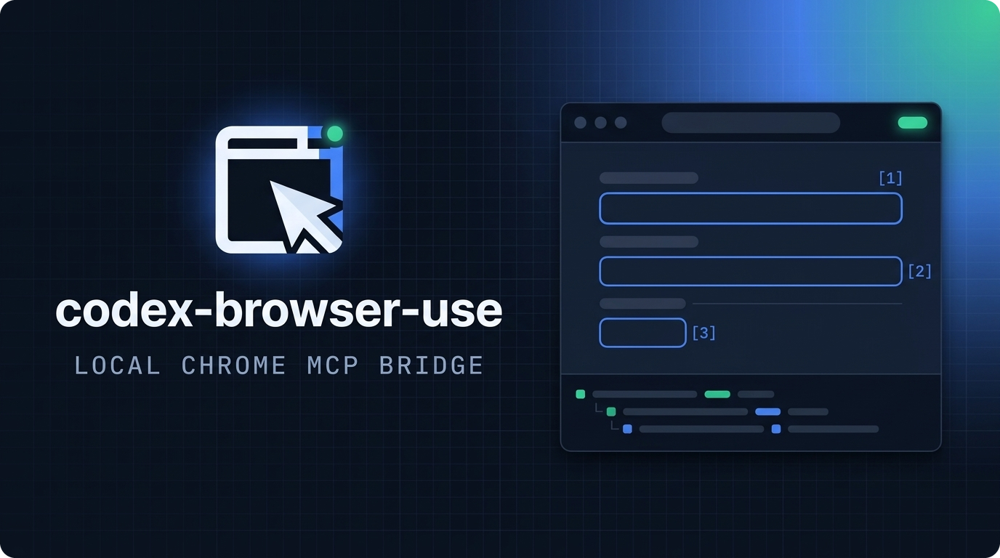
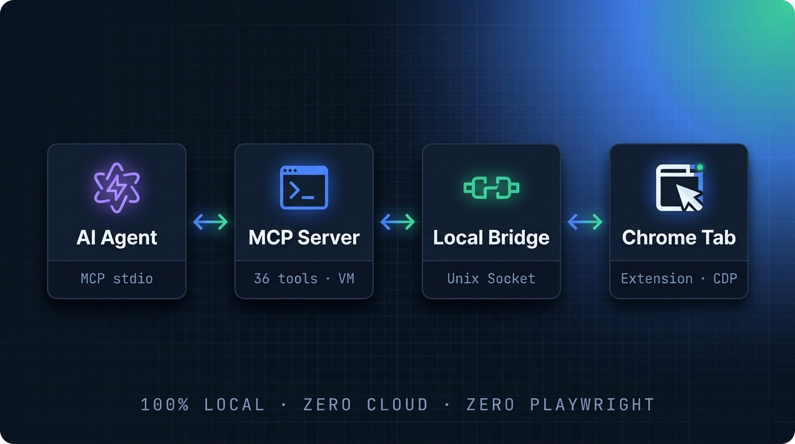
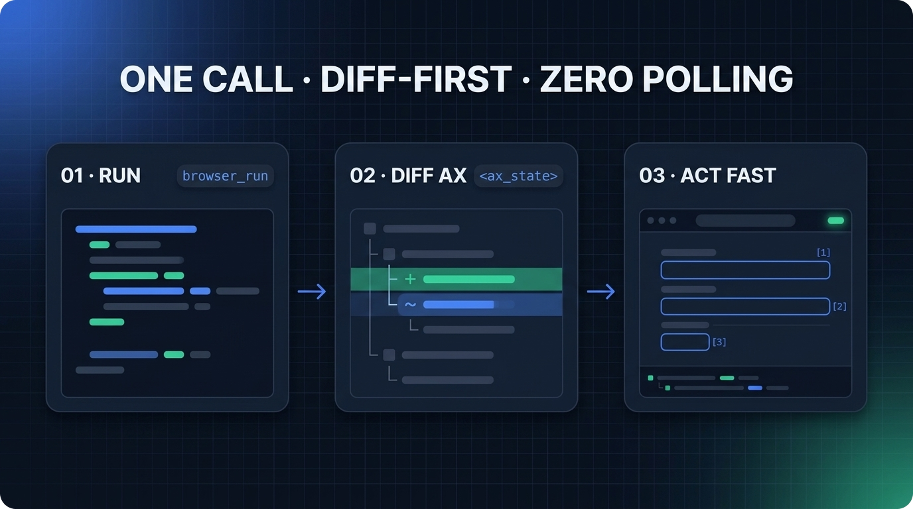
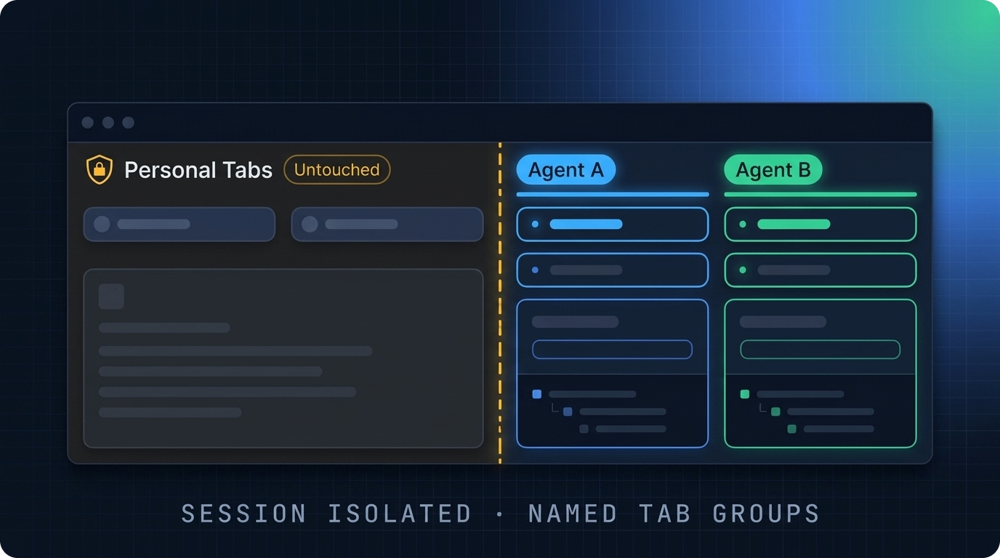

<div align="center">


# codex-browser-use

### 어떤 코딩 에이전트든 사용자의 실제 Chrome 브라우저를 제어할 수 있는 초고속 로컬 MCP.

**Codex의 Browser Use 기능이 너무 좋아서 — 모든 코딩 에이전트에서 쓸 수 있도록 오픈소스로 처음부터 다시 만들고 더 빠르게 튜닝했습니다.**

[English](../../README.md) · [Tiếng Việt](README_vi.md) · [简体中文](README_zh-CN.md) · [日本語](README_ja.md) · **한국어**

[](../../LICENSE)
[](https://codex-browser-use.vercel.app)
[](#빠른-시작)
[](#왜-더-나은가)
[](#빠른-시작)
[](https://github.com/khanhle1406/codex-browser-use/stargazers)

[웹사이트](https://codex-browser-use.vercel.app) · [빠른 시작](#빠른-시작) · [동작 원리](#동작-원리) · [활용 예시](#할-수-있는-일) · [왜 더 나은가](#왜-더-나은가) · [자주 묻는 질문](#자주-묻는-질문-faq) · [문서](#문서)

<code>node mcp-server/bin/browser-use.js install --client antigravity --write --skill</code>

</div>

<div align="center">

<br />



</div>

---

코딩 에이전트가 웹사이트를 열고, 버튼을 클릭하고, 폼을 채우고, 앱이 실제로 동작하는지 검증하길 원하시나요? 보통 Playwright를 설치하고 무거운 별도 브라우저를 새로 띄운 뒤, 거대한 HTML 덤프와 전체 화면 스크린샷으로 토큰 한도를 빠르게 소진하게 됩니다.

OpenAI Codex는 실제 실행 중인 Chrome 브라우저에 바로 연결하고 원본 HTML 대신 짧은 번호 목록으로 페이지를 읽어 이 문제를 깔끔하게 풀었습니다. 유일한 아쉬움은 Codex 안에서만 동작한다는 점이었습니다. 그래서 저는 **모든 코딩 에이전트**에서 동작하는 무료 오픈소스 도구로 처음부터 다시 제작했고, 속도까지 한층 더 끌어올렸습니다.

설정은 명령어 한 줄이면 충분합니다. 가벼운 Chrome 확장 프로그램을 복사하고 로컬 브리지를 등록하며, 전체 에이전트 스킬 번들과 상시 규칙을 자동으로 설치합니다. 에이전트는 현재 열려 있는 Chrome 안에서 동작하므로 기존 쿠키와 로그인 세션을 그대로 유지하면서도 사용자의 개인 탭과 작업 창은 전혀 건드리지 않습니다.

## 빠른 시작

필요 환경: **Node.js 26.12.1 이상**, npm, 그리고 Chrome(또는 Chromium, Edge, Brave).

### 에이전트 설정하기

저장소 루트 폴더에서 아래 명령어를 실행하세요 (npm 배포 후에는 `npx -y codex-browser-use ...` 로도 실행 가능):

```sh
npm --prefix mcp-server ci
node mcp-server/bin/browser-use.js install --client antigravity --write --skill
node mcp-server/bin/browser-use.js doctor --json
```

`install --skill` 명령은 Chrome 확장(`v0.6.4`) 복사, 로컬 Chrome Native Messaging 호스트 등록, 클라이언트 MCP 설정 작성(`.bak` 백업 먼저 생성), 전체 스킬 번들(`skill/SKILL.md` + `skill/references/cookbook.md` + `skill/references/tools.md`) 설치, 그리고 지원 클라이언트에 대한 상시 규칙 파일(`rules/browser_use.md`, Cursor의 경우 `.cursor/rules/browser_use.mdc`) 설치까지 자동으로 처리합니다(`--no-rules`로 건너뛰거나 `--rules` 단독 실행 가능).

<details>
<summary><strong>지원 클라이언트 및 도구 프로필 (<code>--profile auto | compact | standard | full</code>)</strong></summary>

| 클라이언트 | MCP 설정 파일 | 스킬 디렉터리 | `--skill` 시 설치되는 규칙 |
| --- | --- | --- | --- |
| `antigravity` | `~/.gemini/config/mcp_config.json` | `~/.gemini/config/skills/codex-browser-use/` | `~/.gemini/config/rules/browser_use.md` |
| `commandcode` | `~/.commandcode/mcp.json` | `~/.agents/skills/codex-browser-use/` | `~/.agents/rules/browser_use.md` *(`--profile compact` 또는 `auto` 권장)* |
| `cursor` | `~/.cursor/mcp.json` | `~/.cursor/skills/codex-browser-use/` | `~/.cursor/rules/browser_use.mdc` *(Cursor 프론트매터 포함)* |
| `windsurf` | `~/.codeium/windsurf/mcp_config.json` | `~/.codeium/windsurf/skills/codex-browser-use/` | `~/.codeium/windsurf/rules/browser_use.md` |
| `copilot` | `~/.copilot/mcp-config.json` | `~/.agents/skills/codex-browser-use/` | `~/.agents/rules/browser_use.md` |
| `claude_code` | `~/.claude.json` | `~/.claude/skills/codex-browser-use/` | *(건너뜀)* |
| `codex` | `config`로 TOML 출력 | `~/.codex/skills/codex-browser-use/` | *(건너뜀)* |
| `opencode` / `generic` | `config`로 설정 출력 | `~/.agents/skills/codex-browser-use/` | `~/.agents/rules/browser_use.md` |

지연 로딩을 쓰지 않는 CLI 클라이언트(Codex, Claude Code, Command Code, Copilot, OpenCode)에는 `--profile auto`(CLI는 `"compact"`, 지연 로딩 IDE는 `"full"` 자동 선택) 또는 `--profile compact` / `BROWSER_USE_TOOL_PROFILE=compact`를 지정하세요. 핵심 7개 도구만 등록해 고정 도구 스키마 크기를 **75.4%** 절감합니다(`30,302` 바이트 / 예상 `~7,576` 토큰 → `7,457` 바이트 / 예상 `~1,865` 토큰):

```sh
node mcp-server/bin/browser-use.js install --client commandcode --write --skill --profile auto
node mcp-server/bin/browser-use.js config --client codex --profile auto
```

Codex 또는 OpenCode의 경우 설정 스니펫을 출력하고 스킬을 설치합니다:

```sh
node mcp-server/bin/browser-use.js config --client codex
node mcp-server/bin/browser-use.js config --client opencode
node mcp-server/bin/browser-use.js install --client codex --skill
```

</details>

### Chrome 연결하기

1. `chrome://extensions`를 열고 **개발자 모드(Developer mode)**를 켠 뒤 **압축해제된 확장 프로그램을 로드합니다(Load unpacked)**를 눌러 `~/.local/share/browser-use/extension`을 선택하세요.
2. 끝입니다 — **Portable Browser Bridge**가 백그라운드에서 자동 연결됩니다(아이콘에 마우스를 올리면 상태를 확인하고, 클릭하면 일시정지/재연결할 수 있습니다).
3. 코딩 에이전트를 재시작해 MCP 도구를 불러오세요.

### 에이전트에게 요청하기

연결되면 자연어로 지시하기만 하면 됩니다:

```text
Open http://127.0.0.1:3000 in a Chrome tab group called "App QA".
Test the signup form on desktop and mobile sizes, check for any console
or failed network errors, save an element screenshot of the signup card,
and leave the final tab open for me to check.
```

## 동작 원리

### 1. 모든 동작이 내 컴퓨터 안에서 완결됨

에이전트는 로컬 MCP 서버(`v4.8.1`)와 통신하며, 서버는 가벼운 확장 프로그램(`v0.6.4`)을 통해 실행 중인 Chrome으로 명령을 직접 전달합니다. 클라우드 서버도, Playwright 브라우저 다운로드도, 외부에 노출되는 백그라운드 서버도 없습니다.



### 2. 한 턴으로 끝내는 멀티 스텝, 최소 토큰, 불필요한 폴링 제로

작은 동작마다 AI 메시지를 한 턴씩 쓰는 대신 `browser_run` 한 번으로 전체 다단계 흐름(최대 `300,000` ms / `5`분)을 실행하고 최대 `10`개 URL을 병렬 처리(`browser.tabs.content()`)할 수 있습니다. 페이지 스냅샷은 `browser_run`, `browser_batch`, `ariaSnapshot()` 전반에서 `mode: "compact"`가 기본값(`"full"` 및 `"interactive"` 선택 가능)이며 `ariaSnapshot()`과 `getState()` 간 통합 AX diff 기준선을 공유합니다. 또한 대화상자나 카드 등 특정 영역만 읽는 `locator.ariaSnapshot()`, 구조화된 콘텐츠 내보내기(`browser_get_content` & `page.content.export()` / `.tables()` / `.links()`), CSS 스케일 스크린샷(기본 `max_width` `1280` px, JPEG 품질 `75`), diff 기반 업데이트를 통해 토큰 사용량을 극도로 줄입니다.

`v4.7.0`–`v4.8.1`에서는 `browser_run`에 컨텍스트 비대화를 막는 로컬 파일 헬퍼(`saveFile`, `readFile`, `emit: true` 지원 `saveScreenshot`, `nodeRepl` 별칭 및 `saved_files` 자동 메타데이터 반환), 요소만 타이트하게 자르는 `locator.screenshot()` / `page.elementScreenshot()`, `tab.ax.paste()` / `tab.ax.selectText()`, `page.innerText()` / `page.textContent()` / `page.check()` 단축 메서드, 로컬 `{}`/`[]` 생성을 지원하는 읽기 전용 `evaluate()`, `tab.dev.enableNetwork({ captureBodies: true })` + `tab.dev.responseBody(requestId)` 네트워크 응답 본문 캡처, 탭 그룹 통합, 그리고 `--profile auto` 자동 선택이 추가되었습니다.



<details>
<summary><strong>예제: 다중 URL 병렬 추출, 파일 저장 및 요소 스크린샷 증적 확보</strong></summary>

```json
{
  "name": "browser_run",
  "arguments": {
    "return_state": "none",
    "end_turn": true,
    "code": "await browser.nameSession('Docs Audit', 'cyan');\nconst pages = await browser.tabs.content([\n  'https://example.com/docs',\n  'https://example.com/pricing'\n], { format: 'markdown', concurrency: 2 });\nconst saved = await saveFile('/abs/path/docs-export.json', pages);\nconst pricingTab = await browser.tabs.new('https://example.com/pricing');\nawait pricingTab.locator('css=.plan-card').first().saveScreenshot('/abs/path/plan-card.png', { padding: 12, emit: true });\nawait pricingTab.markDeliverable();\nreturn { extracted: pages.length, file: saved.path };"
  }
}
```

또는 단계 목록(`goto`, `set_viewport`, `locator_fill`, `locator_click`, `wait`, `get_state`, `get_content`, `read_tab`, `evaluate`)을 `browser_batch`로 한 번에 전달할 수도 있습니다.

</details>

### 3. 열린 탭 제어 또는 전용 에이전트 탭 격리 — 논블로킹 가상 커서 지원

에이전트는 이름과 색상이 지정된 전용 Chrome 탭 그룹 안에서 새 탭을 열고(`target="_blank"` 팝업도 자동 연결 및 `page.waitForEvent("popup")` 감지 가능), Chrome 디버거를 붙이지 않고 열려 있는 사용자 탭을 수동(passive)으로 읽거나(`browser.tabs.read(id)` / `browser.user.getTabContext(id)` 및 `chrome.scripting.executeScript` 기반 수동 `browser_get_content`), 조건에 맞는 기존 탭만 선택해 제어할 수 있습니다. 작업 중에는 가상 커서와 탭 배지가 클릭 및 입력 위치를 표시하며(`BROWSER_USE_CURSOR_MODE=fast|smooth|off`, 기본 `fast`는 차단 지연 `0` ms), 작업 종료 시 임시 탭은 자동 정리되고 개인 탭은 안전하게 유지됩니다.



## 할 수 있는 일

| 하고 싶은 작업 | 지원 방식 |
| --- | --- |
| **웹 앱 테스트** | 폼 입력(CKEditor 4/5, TinyMCE, Quill, `contenteditable` 스마트 서식 채우기 및 `ax.paste`/`ax.selectText`), 데스크톱/모바일 뷰포트 전환, 요소 스크린샷(`locator.screenshot()`), 콘솔 오류 및 API 응답 본문(`dev.responseBody()`) 검사. |
| **다중 페이지 수집 및 점검** | 최대 `10`개 URL 병렬 추출(`browser.tabs.content()`), 5분(`300s`) 페이지네이션 루프 실행, 대화 컨텍스트를 오염시키지 않는 `saveFile()` 대용량 로컬 저장, `page.assets.list()` 및 WebMCP 도구(`page.webmcp`) 조회. |
| **복잡한 UI 조작** | Shadow DOM, 동일/교차 출처 iframe(OOPIF), 파일 업로드 선택기, 대용량 파일 다운로드를 지원하며 `not_found` 타임아웃 시 가장 가까운 로케이터 힌트를 제공. |
| **Chrome 깔끔하게 유지** | 에이전트 탭을 이름과 색상이 지정된 Chrome 탭 그룹으로 묶고 작업 완료 후 임시 탭을 자동 정리. |
| **로그인 및 CAPTCHA 안전 처리** | 보안 검사를 우회하려 하지 않습니다 — 인증이 필요하면 `handoff`로 멈추고 탭을 열어두어 사용자가 직접 로그인하도록 안내합니다. |

## 왜 더 나은가

| 기능 | Playwright / 스크린샷 MCP | Codex 내장 Browser Use | `codex-browser-use` |
| --- | :---: | :---: | :---: |
| 모든 코딩 에이전트 지원 | ✅ | ❌ Codex 전용 | ✅ 모든 MCP 에이전트 |
| 실제 Chrome 사용(별도 브라우저 없음) | ❌ 무거운 별도 브라우저 | ✅ | ✅ |
| 100% MIT 오픈소스(폐쇄형 바이너리 없음) | ✅ | ❌ 비공개 런타임 | ✅ 순수 Node.js + MV3 |
| 1회 호출로 멀티 스텝 & 병렬 탭 실행 | ❌ 턴당 한 단계 | ✅ | ✅ + `tabs.new` & `tabs.content` |
| 짧은 번호 개요 + 로컬 `saveFile` | ❌ 거대한 DOM / PNG | ✅ | ✅ Diff 우선 + `mode` 압축 |
| 이름 지정 Chrome 탭 그룹 | ❌ | ✅ | ✅ |
| 타이머 폴링 없는 빠른 로컬 속도 | ❌ 단계별 대기 지연 | ✅ | ✅ 병렬 실행 최대 6.83x 향상 |

내부적으로 명령은 로컬 소켓을 통해 병렬 실행되며 타이머 폴링 대신 Chrome 페이지 이벤트를 직접 대기합니다 — 그 결과 4개 탭 병렬 작업이 **6.83배**, 전체 페이지+iframe+스크린샷 읽기가 **약 3배** 빨라졌습니다. `v4.6.0`–`v4.8.1`에 걸쳐 페이지 내 영구 로케이터 런타임 캐시(`globalThis.__buRt` v2)는 연속 10회 호출 페이로드를 `379,520` B에서 `1,260` B로(**99.7% 절감**), `compact` AX 스냅샷은 **81.7%**(`3,812` → `699`자), `markdown` 본문 추출은 원문 대비 **94.1%**(`1,524` → `90`자), `--profile compact`는 MCP 도구 스키마를 **75.4%** 줄였습니다. 실제 Chrome 환경 동일 모델(`gpt-6.1-terra`, medium) 4종 과업 비교 벤치마크에서 `codex-browser-use`(`--profile compact`)는 Codex 내장 Chrome 플러그인 대비 전체 실행 시간 **28.8% 단축**(`55.79s` vs `78.38s`), 브라우저 실행 속도 **3.80배 향상**(`3.48s` vs `13.21s`), 총 입력 토큰 **51.9% 절감**(`305,934` vs `636,008`)을 기록했습니다.

<details>
<summary><strong>전체 벤치마크 수치 확인 및 직접 실행하기</strong></summary>

#### 동일 모델 라이브 에이전트 벤치마크 (`gpt-6.1-terra medium`, 실제 Chrome)

결정적 4개 과업 Chrome 포털(2페이지 모달 스크래핑, Shadow DOM + `contenteditable` 폼 제출, 스크린샷 증적, 토큰 감사 — 양쪽 모두 **100/100** 점수)을 대상으로 [agent-benchmark.mjs](../../mcp-server/bench/agent-benchmark.mjs)로 E2E 측정:

| 지표 | Codex 내장 Chrome 플러그인 (`node_repl:js`) | `codex-browser-use` (`--profile compact`) | 검증된 향상 |
| --- | ---: | ---: | --- |
| **점수** | `100 / 100` | **`100 / 100`** | 동일 정확도(모달 `8/8`, 제출 `1`) |
| **총 소요 시간 (Wall-Clock)** | `78.38s` (`78,380 ms`) | **`55.79s`** (`55,792 ms`) | **28.8% 더 빠름** (`-22.59s`) |
| **첫 브라우저 동작까지 시간 (TTFA)** | `28.65s` (`28,646 ms`) | **`12.86s`** (`12,860 ms`) | **55.1% 더 빠름** |
| **브라우저 실행 시간** | `13.21s` (`13,207 ms`) | **`3.48s`** (`3,476 ms`) | **3.80배 더 빠름** (`-73.7%`) |
| **브라우저 도구 호출 수** | `12` | **`8`** | **호출 33.3% 감소** |
| **총 입력 토큰 (캐시 포함)** | `636,008` | **`305,934`** | **토큰 51.9% 절감** |
| **비캐시 입력 토큰** | `52,584` | **`20,494`** | **토큰 61.0% 절감** |

Chrome에서 직접 라이브 에이전트 벤치마크 실행 (`same-model`, `head-to-head`, 또는 `all`):

```sh
npm --prefix mcp-server run bench:agents -- --mode same-model
```

#### 핵심 IPC &amp; 페이로드 마이크로 벤치마크

Node `v26.13.0` 환경에서 [perf-benchmark.mjs](../../mcp-server/bench/perf-benchmark.mjs)로 측정(실제 로컬 소켓, Native Messaging 스트림, 인메모리 MCP 전송, 최적화 전후 동일한 시뮬레이션 페이지 지연 조건):

| 측정 항목 | 최적화 전 / 기준선 | 최적화 후 | 검증된 향상 |
| --- | --- | --- | --- |
| **4개 병렬 탭** (`goto` + 페이지 읽기) | `606.79 ms` | **`88.86 ms`** | **6.83배 빠름** (`-85.4%`) |
| **페이지 + 4 Iframe + 스크린샷** | `267.63 ms` / `226.38 ms` | **`90.88 ms`** / **`72.59 ms`** | **2.94배**(콜드) / **3.12배**(웜) |
| **페이지 로드 대기** (+ 리소스) | `130.54 ms` (`10`회 폴링) | **`113.58 ms`** (**`0`**회 폴링) | **폴링 체크 제로화** |
| **요소 및 텍스트 대기** (`90ms` 지연) | `406.74 ms` (`8`회 확인) | **`289.37 ms`** (`3`회 확인) | **1.41배 빠름** / 호출 `-62.5%` |
| **연속 10개 필드 입력** | `399.85 ms` (`40`회 호출) | **`187.89 ms`** (`20`회 호출) | **2.13배 빠름** (호출 절반) |
| **Iframe 내부 10회 클릭** | `494.31 ms` (`51`회 호출) | **`151.28 ms`** (`15`회 호출) | **3.27배 빠름** (호출 `-70.6%`) |
| **확장 스트림 & 40개 대용량 응답** | `34.18 ms` / `120` 메시지 | **`26.57 ms`** / **`40` 메시지** | CPU `-22.3%` / **메시지 `-66.7%`** |
| **로컬 소켓 40 MB 전송** | `263.01 ms` (`152.1 MB/s`) | **`132.20 ms`** (**`302.6 MB/s`**) | **처리량 약 2.0배** |
| **로케이터 런타임 캐시 (`10`회 호출)** | `379,520 B` (`2.73 ms`) | **`1,260 B`** (**`1.13 ms`**) | **페이로드 99.7% 축소** |
| **MCP 도구 스키마 (`compact` vs `full`)** | `30,302 B` (`~7,576` tok, `36`개) | **`7,457 B`** (**`~1,865` tok, `7`개**) | **스키마 75.4% 축소** |
| **AX `compact` & Markdown 추출** | `3,812` AX / `1,524` 문자 | **`699`** AX / **`90`** 문자 | **81.7%** AX / **94.1%** 본문 절감 |

로컬에서 마이크로 벤치마크 실행:

```sh
npm --prefix mcp-server run bench
```

</details>

<details>
<summary><strong>전체 36개 MCP 도구 및 프로필 보기 (compact / standard / full)</strong></summary>

`--profile compact|standard|full`(또는 `BROWSER_USE_TOOL_PROFILE`)을 사용하세요: **`compact`**는 핵심 7개 도구(`browser_run`, `browser_batch`, `browser_get_state`, `browser_goto`, `browser_list_tabs`, `browser_screenshot`, `browser_end_turn`)만 등록해 고정 스키마 크기를 `30,302 B` / `~7,576` 토큰에서 `7,457 B` / `~1,865` 토큰으로 `75.4%` 줄이고, **`standard`**는 14개 도구(`~3,023` 토큰), **`full`**(전체 36개 도구)은 지연 로딩 지원 IDE의 기본값입니다.

| 그룹 | 도구 목록 |
| --- | --- |
| **멀티 스텝 & 상태** (`3`) | `browser_run`, `browser_batch`, `browser_status` |
| **읽기 & 디버그** (`8`) | `browser_get_state`, `browser_screenshot`, `browser_get_content`, `browser_dom_snapshot`, `browser_inspect_element`, `browser_console_logs`, `browser_network_logs`, `browser_evaluate` |
| **클릭, 입력 & 파일** (`9`) | `browser_click`, `browser_set_value`, `browser_type_text`, `browser_press_key`, `browser_select_option`, `browser_hover`, `browser_drag`, `browser_scroll`, `browser_upload_files` |
| **스마트 로케이터, 대기 & 화면 크기** (`4`) | `browser_locator_click`, `browser_locator_fill`, `browser_wait_for`, `browser_set_viewport` |
| **탐색, 탭 & 그룹** (`9`) | `browser_goto`, `browser_back`, `browser_forward`, `browser_reload`, `browser_list_tabs`, `browser_new_tab`, `browser_select_tab`, `browser_close_tab`, `browser_name_session` |
| **팝업 & 정리** (`3`) | `browser_handle_dialog`, `browser_end_turn`, `browser_reset` |

</details>

## 자주 묻는 질문 (FAQ)

<details>
<summary><strong>어떤 코딩 에이전트에서 사용할 수 있나요?</strong></summary>

로컬 MCP 도구를 지원하는 모든 에이전트에서 동작합니다: Antigravity, Claude Code, Codex CLI, Cursor, Windsurf, GitHub Copilot CLI, Command Code, OpenCode 및 커스텀 환경.

</details>

<details>
<summary><strong>에이전트가 내 개인 탭이나 저장된 비밀번호를 볼 수 있나요?</strong></summary>

기본적으로 확장 프로그램은 에이전트 세션 전용 탭을 생성하며 개인 탭, 북마크, 관련 없는 창은 건드리지 않습니다. 열려 있는 탭 검사를 명시적으로 요청한 경우에도 수동 읽기(`browser.tabs.read(id)` / `browser.user.getTabContext(id)` / 수동 `browser_get_content`)는 Chrome 디버거를 연결하지 않고 동작하며, 읽기 전용 평가(`browser_evaluate`)는 페이지 수정, 스토리지 쓰기, 네트워크 호출을 차단합니다.

</details>

<details>
<summary><strong>그냥 Playwright MCP를 쓰면 안 되나요?</strong></summary>

Playwright는 무거운 별도 브라우저를 설치하고, 매번 쿠키나 로그인 없는 빈 상태로 시작하며, 동작마다 거대한 DOM 덤프나 전체 PNG를 보내기 일쑤입니다. `codex-browser-use`는 실행 중인 Chrome에 곧바로 연결되어 기존 쿠키와 로그인 세션, 작업 탭을 그대로 유지하면서 짧은 페이지 개요, 이름 지정 탭 그룹, 로컬 `saveFile`/`saveScreenshot`, 원콜 스크립트를 제공합니다.

</details>

<details>
<summary><strong>로그인 페이지, 2FA, CAPTCHA가 나오면 어떻게 되나요?</strong></summary>

에이전트는 로그인이나 CAPTCHA를 우회하려 들지 않도록 지침이 설정되어 있습니다. 인증이 필요한 페이지가 나타나면 에이전트가 `handoff`로 일시 중지하고 Chrome에서 직접 로그인해 달라고 요청한 뒤, 완료되면 이어서 작업을 재개합니다.

</details>

<details>
<summary><strong>업데이트나 정상 동작 확인은 어떻게 하나요?</strong></summary>

최신 코드를 받은 뒤 `node mcp-server/bin/browser-use.js install --client <클라이언트명> --skill`을 실행하고, `chrome://extensions`에서 **Portable Browser Bridge**의 **새로고침(Reload)**을 누른 다음 `node mcp-server/bin/browser-use.js doctor --json`을 실행하세요.

</details>

## 문서

언제든지 테스트, 린트, 상태 점검을 실행할 수 있습니다:

```sh
npm --prefix mcp-server test
npm --prefix mcp-server run lint
npm --prefix mcp-server run bench
npm --prefix mcp-server run bench:agents -- --mode same-model
node mcp-server/bin/browser-use.js doctor --json
```

- [에이전트 스킬 지침서 (SKILL.md)](../../skill/SKILL.md) — 코딩 에이전트에 설치되는 워크플로 가이드 및 v4.8.1 API 레퍼런스
- [워크플로 쿡북 (Cookbook)](../../skill/references/cookbook.md) — 페이지네이션, 수동 탭 읽기, `responseBody()`, 스크린샷 복사-붙여넣기 레시피
- [도구 프로필 및 목록](../../skill/references/tools.md) — `--profile auto|compact|standard|full` 비교 및 전체 36개 도구 목록
- [브라우저 정책 규칙](../../rules/browser_use.md) — 상시 적용 보안 및 토큰 절약 규칙
- [호환성 및 엔진 모드](../../docs/compatibility.md) — 독립 실행 구성 세부 기록
- [전송 및 IPC 조사 노트](../../docs/transport-investigation.md) — 로컬 소켓 및 네이티브 브리지 동작 방식
- [구형 v1 참고 문서](../../docs/legacy-v1.md) — 이전 v1 아키텍처 참고 자료

## 기여하기

이슈와 PR은 [khanhle1406/codex-browser-use](https://github.com/khanhle1406/codex-browser-use)에서 언제든 환영합니다.

## 라이선스

[MIT](../../LICENSE)
