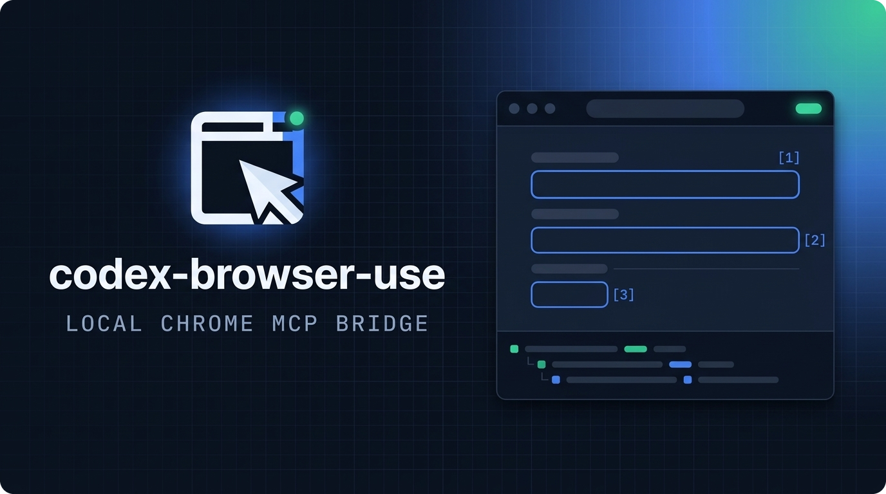
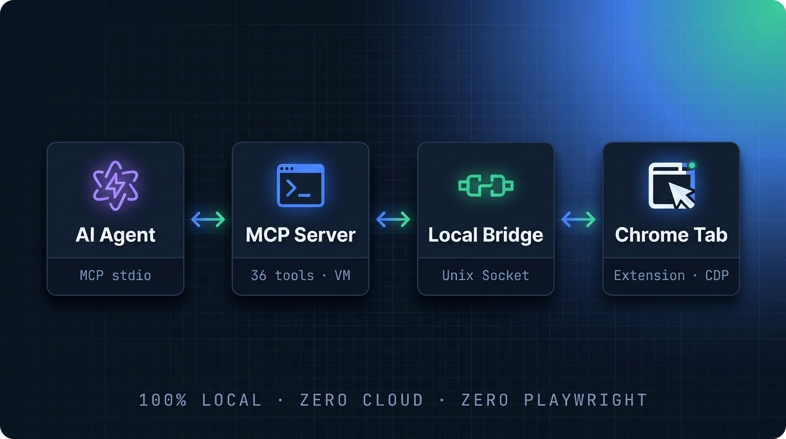
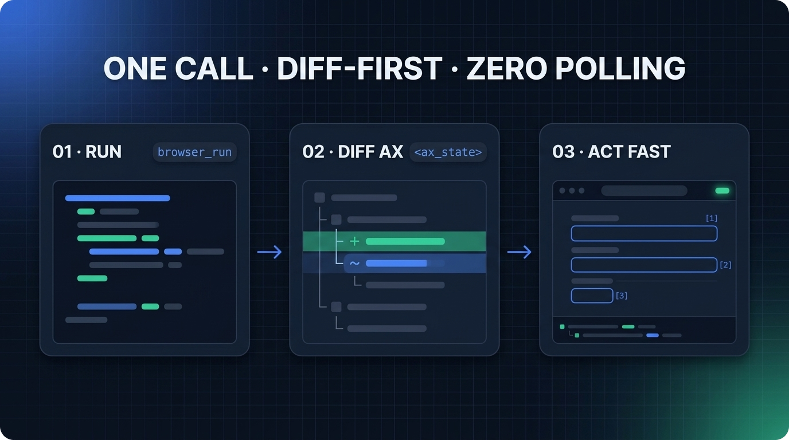
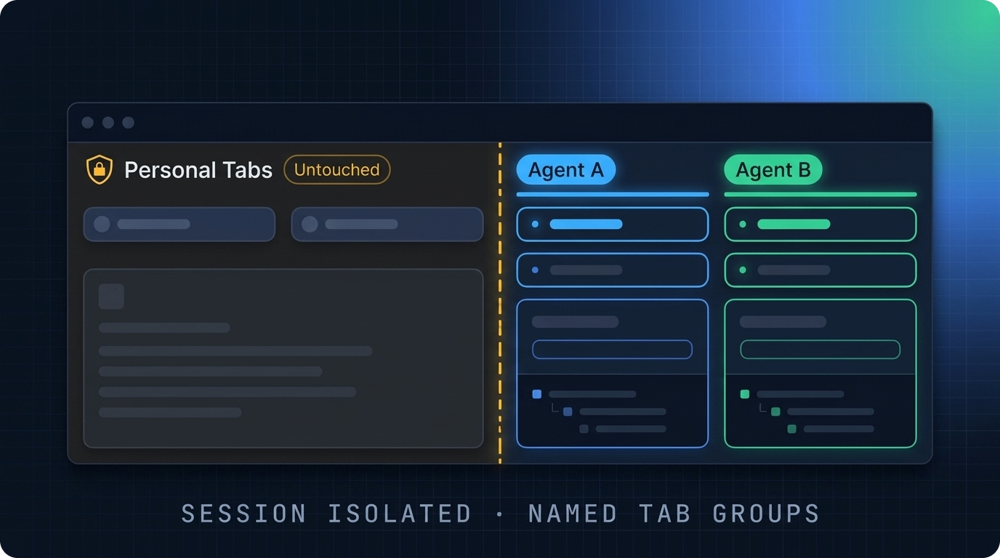

<div align="center">


# codex-browser-use

### Một MCP cục bộ siêu nhanh giúp mọi coding agent điều khiển trình duyệt Chrome thật của bạn.

**Tính năng Browser Use của Codex quá ngon — nên tôi đã làm lại thành một phiên bản mã nguồn mở nhanh hơn cho mọi coding agent.**

[English](../../README.md) · **Tiếng Việt** · [简体中文](README_zh-CN.md) · [日本語](README_ja.md) · [한국어](README_ko.md)

[](../../LICENSE)
[](https://codex-browser-use.vercel.app)
[](#bắt-đầu-nhanh)
[](#vì-sao-tốt-hơn)
[](#bắt-đầu-nhanh)
[](https://github.com/khanhle1406/codex-browser-use/stargazers)

[Website](https://codex-browser-use.vercel.app) · [Bắt đầu nhanh](#bắt-đầu-nhanh) · [Cách hoạt động](#cách-hoạt-động) · [Khả năng](#bạn-có-thể-làm-gì) · [Vì sao tốt hơn](#vì-sao-tốt-hơn) · [Hỏi đáp](#hỏi-đáp-faq) · [Tài liệu](#tài-liệu)

<code>node mcp-server/bin/browser-use.js install --client antigravity --write --skill</code>

</div>

<div align="center">

<br />



</div>

---

Bạn muốn coding agent của mình mở website, bấm nút, điền biểu mẫu và kiểm tra xem ứng dụng web có thực sự hoạt động không? Thông thường việc đó đồng nghĩa với việc phải cài Playwright, khởi chạy thêm một trình duyệt nặng nề trắng tinh, và đốt sạch giới hạn token vì những đoạn HTML khổng lồ cùng ảnh chụp màn hình liên tục.

OpenAI Codex đã giải quyết bài toán này rất gọn bằng cách kết nối thẳng tới trình duyệt Chrome thật của bạn và đọc trang web dưới dạng danh sách đánh số ngắn gọn thay vì HTML thô. Điểm vướng duy nhất là nó chỉ chạy bên trong Codex. Vì vậy tôi đã viết lại ý tưởng này từ đầu thành một công cụ miễn phí, mã nguồn mở dùng được với **mọi coding agent** — và tinh chỉnh để chạy còn nhanh hơn nữa.

Cài đặt chỉ mất một dòng lệnh. Công cụ sẽ cài một extension Chrome nhỏ gọn, đăng ký cầu nối cục bộ, và tự động cài đặt trọn bộ skill cùng quy tắc luôn bật cho agent. Agent làm việc ngay trong cửa sổ Chrome bạn đang mở — giữ nguyên cookie và các phiên đã đăng nhập — trong khi vẫn giữ nguyên vẹn các tab cá nhân và công việc đang mở của bạn.

## Bắt đầu nhanh

Bạn cần **Node.js 26.12.1 trở lên**, npm và Chrome (hoặc Chromium, Edge, Brave).

### Cài đặt cho agent của bạn

Chạy các lệnh sau từ thư mục gốc của repo (hoặc dùng `npx -y codex-browser-use ...` sau khi gói được phát hành trên npm):

```sh
npm --prefix mcp-server ci
node mcp-server/bin/browser-use.js install --client antigravity --write --skill
node mcp-server/bin/browser-use.js doctor --json
```

Lệnh `install --skill` sẽ sao chép extension Chrome (`v0.6.4`), đăng ký Chrome Native Messaging host cục bộ, ghi cấu hình MCP cho client (có tạo bản sao lưu `.bak` trước), cài đặt đầy đủ gói skill (`skill/SKILL.md` + `skill/references/cookbook.md` + `skill/references/tools.md`), và tự động cài file quy tắc luôn bật (`rules/browser_use.md`, hoặc `.cursor/rules/browser_use.mdc` với Cursor) khi client hỗ trợ (truyền `--no-rules` để bỏ qua, hoặc chạy `--rules` riêng).

<details>
<summary><strong>Các client hỗ trợ &amp; profile công cụ (<code>--profile auto | compact | standard | full</code>)</strong></summary>

| Client | Tệp cấu hình MCP | Thư mục Skill | Quy tắc cài bởi `--skill` |
| --- | --- | --- | --- |
| `antigravity` | `~/.gemini/config/mcp_config.json` | `~/.gemini/config/skills/codex-browser-use/` | `~/.gemini/config/rules/browser_use.md` |
| `commandcode` | `~/.commandcode/mcp.json` | `~/.agents/skills/codex-browser-use/` | `~/.agents/rules/browser_use.md` *(khuyên dùng `--profile compact` hoặc `auto`)* |
| `cursor` | `~/.cursor/mcp.json` | `~/.cursor/skills/codex-browser-use/` | `~/.cursor/rules/browser_use.mdc` *(có sẵn frontmatter Cursor)* |
| `windsurf` | `~/.codeium/windsurf/mcp_config.json` | `~/.codeium/windsurf/skills/codex-browser-use/` | `~/.codeium/windsurf/rules/browser_use.md` |
| `copilot` | `~/.copilot/mcp-config.json` | `~/.agents/skills/codex-browser-use/` | `~/.agents/rules/browser_use.md` |
| `claude_code` | `~/.claude.json` | `~/.claude/skills/codex-browser-use/` | *(bỏ qua)* |
| `codex` | In đoạn TOML qua `config` | `~/.codex/skills/codex-browser-use/` | *(bỏ qua)* |
| `opencode` / `generic` | In cấu hình qua `config` | `~/.agents/skills/codex-browser-use/` | `~/.agents/rules/browser_use.md` |

Với các client CLI không lazy-load tool (Codex, Claude Code, Command Code, Copilot, OpenCode), hãy truyền `--profile auto` (tự chọn `"compact"` cho CLI và `"full"` cho IDE có lazy-loading) hoặc `--profile compact` / `BROWSER_USE_TOOL_PROFILE=compact` để chỉ đăng ký 7 tool cốt lõi, cắt **75.4%** dung lượng schema cố định (`7,457` bytes / `~1,865` token ước tính so với `30,302` bytes / `~7,576` token):

```sh
node mcp-server/bin/browser-use.js install --client commandcode --write --skill --profile auto
node mcp-server/bin/browser-use.js config --client codex --profile auto
```

Với Codex hoặc OpenCode, in đoạn cấu hình và cài skill:

```sh
node mcp-server/bin/browser-use.js config --client codex
node mcp-server/bin/browser-use.js config --client opencode
node mcp-server/bin/browser-use.js install --client codex --skill
```

</details>

### Kết nối Chrome

1. Mở `chrome://extensions`, bật **Developer mode** (Chế độ dành cho nhà phát triển), bấm **Load unpacked** (Tải tiện ích đã giải nén), và chọn `~/.local/share/browser-use/extension`.
2. Xong — **Portable Browser Bridge** tự động kết nối ngầm (rê chuột lên biểu tượng để xem trạng thái, hoặc bấm để tạm dừng / kết nối lại).
3. Khởi động lại coding agent để agent nạp các công cụ MCP.

### Ra lệnh cho agent

Sau khi kết nối, chỉ cần yêu cầu bằng ngôn ngữ tự nhiên:

```text
Open http://127.0.0.1:3000 in a Chrome tab group called "App QA".
Test the signup form on desktop and mobile sizes, check for any console
or failed network errors, save an element screenshot of the signup card,
and leave the final tab open for me to check.
```

## Cách hoạt động

### 1. Mọi thứ đều nằm trên máy của bạn

Agent giao tiếp với máy chủ MCP cục bộ (`v4.8.1`), sau đó gửi lệnh thẳng vào trình duyệt Chrome đang chạy qua một extension gọn nhẹ (`v0.6.4`). Không có dịch vụ cloud, không tải thêm trình duyệt Playwright và không mở server nền lộ ra mạng.

 MCP Server -> Cầu nối cục bộ -> Tab Chrome" width="100%" />

### 2. Một lượt chạy, tốn cực ít token, không chờ polling lãng phí

Thay vì mỗi bước nhỏ lại tốn một tin nhắn AI, agent có thể chạy cả một quy trình nhiều bước (tối đa `300,000` ms / `5` phút mỗi lần gọi `browser_run`) và xử lý song song tới `10` URL cùng lúc (`browser.tabs.content()`). Snapshot trang mặc định dùng `mode: "compact"` (có sẵn `"full"` và `"interactive"`) đồng bộ qua `browser_run`, `browser_batch` và `ariaSnapshot()`, chia sẻ chung baseline diff AX giữa `ariaSnapshot()` và `getState()`, hỗ trợ chụp cây con theo phạm vi `locator.ariaSnapshot()` (ví dụ chỉ một hộp thoại hoặc card), xuất nội dung có cấu trúc (`browser_get_content` & `page.content.export()` / `.tables()` / `.links()`), ảnh chụp thu phóng CSS (`max_width` mặc định `1280` px, JPEG quality `75`), và cập nhật chỉ phần thay đổi — giúp lượng token tiêu thụ siêu nhỏ.

Trong bản cập nhật `v4.7.0`–`v4.8.1`, `browser_run` bổ sung bộ helper ghi/đọc file cục bộ không làm phình context (`saveFile`, `readFile`, `saveScreenshot` kèm `emit: true`, alias `nodeRepl`) tự trả metadata `saved_files`, cắt sát ảnh phần tử qua `locator.screenshot()` / `page.elementScreenshot()`, `tab.ax.paste()` / `tab.ax.selectText()`, các hàm rút gọn `page.innerText()` / `page.textContent()` / `page.check()`, kiểm tra `evaluate()` chỉ đọc hỗ trợ tạo `{}`/`[]` cục bộ, bắt response body mạng qua `tab.dev.enableNetwork({ captureBodies: true })` + `tab.dev.responseBody(requestId)`, tự động hợp nhất Chrome Tab Group, và chọn profile tự động `--profile auto`.



<details>
<summary><strong>Ví dụ: trích xuất song song nhiều URL, ghi ra file và chụp ảnh phần tử làm bằng chứng</strong></summary>

```json
{
  "name": "browser_run",
  "arguments": {
    "return_state": "none",
    "end_turn": true,
    "code": "await browser.nameSession('Docs Audit', 'cyan');\nconst pages = await browser.tabs.content([\n  'https://example.com/docs',\n  'https://example.com/pricing'\n], { format: 'markdown', concurrency: 2 });\nconst saved = await saveFile('/abs/path/docs-export.json', pages);\nconst pricingTab = await browser.tabs.new('https://example.com/pricing');\nawait pricingTab.locator('css=.plan-card').first().saveScreenshot('/abs/path/plan-card.png', { padding: 12, emit: true });\nawait pricingTab.markDeliverable();\nreturn { extracted: pages.length, file: saved.path };"
  }
}
```

Hoặc truyền trực tiếp một danh sách các bước (`goto`, `set_viewport`, `locator_fill`, `locator_click`, `wait`, `get_state`, `get_content`, `read_tab`, `evaluate`) vào `browser_batch`.

</details>

### 3. Điều khiển tab đang mở hoặc tab riêng của agent — kèm con trỏ ảo không gây trễ

Agent có thể mở tab mới trong Chrome Tab Group có tên và màu riêng (tự động nhận popup `target="_blank"` và theo dõi qua `page.waitForEvent("popup")`), đọc thụ động một tab người dùng đang mở mà không gắn Chrome debugger (`browser.tabs.read(id)` / `browser.user.getTabContext(id)` và `browser_get_content` thụ động qua `chrome.scripting.executeScript`), hoặc tiếp quản một tab khớp URL bạn đã mở sẵn. Khi agent thao tác, con trỏ ảo và badge trên tab hiển thị rõ vị trí click và nhập liệu (`BROWSER_USE_CURSOR_MODE=fast|smooth|off`; mặc định `fast` với độ trễ chặn `0` ms). Khi kết thúc tác vụ, các tab tạm của agent tự đóng sạch sẽ trong khi tab cá nhân của bạn được trả lại nguyên vẹn.



## Bạn có thể làm gì

| Việc bạn muốn làm | Công cụ hỗ trợ thế nào |
| --- | --- |
| **Kiểm thử ứng dụng web** | Điền form (hỗ trợ điền rich-text thông minh cho CKEditor 4/5, TinyMCE, Quill, `contenteditable` và `ax.paste`/`ax.selectText`), thử kích thước màn hình desktop/mobile, chụp ảnh phần tử (`locator.screenshot()`), kiểm tra lỗi console hoặc response body từ API (`dev.responseBody()`). |
| **Thu thập dữ liệu & kiểm tra nhiều trang** | Trích xuất song song tối đa `10` URL (`browser.tabs.content()`), chạy vòng lặp phân trang tới `5` phút (`300s`), ghi kết quả lớn thẳng ra ổ đĩa bằng `saveFile()` để không làm nặng khung chat, đọc `page.assets.list()` hoặc công cụ WebMCP (`page.webmcp`). |
| **Bấm các thành phần UI khó** | Xuyên qua Shadow DOM, iframe cùng/khác origin (OOPIFs), hộp chọn file upload và tải xuống tệp dung lượng lớn, kèm gợi ý locator gần nhất khi quá thời gian chờ (`not_found`). |
| **Giữ Chrome gọn gàng** | Gom các tab của agent dưới một nhãn Chrome Tab Group có màu và tên rõ ràng, tự dọn tab tạm sau khi xong. |
| **Xử lý đăng nhập & CAPTCHA an toàn** | Không bao giờ tìm cách vượt kiểm tra bảo mật — agent tạm dừng (`handoff`) và giữ tab mở để bạn tự đăng nhập. |

## Vì sao tốt hơn

| Tính năng | Playwright / Screenshot MCP | Codex Browser Use tích hợp sẵn | `codex-browser-use` |
| --- | :---: | :---: | :---: |
| Dùng được với mọi coding agent | ✅ | ❌ Chỉ Codex | ✅ Mọi agent MCP |
| Dùng Chrome thật (không cài browser phụ) | ❌ Trình duyệt phụ nặng | ✅ | ✅ |
| 100% mã nguồn mở MIT (không file nhị phân đóng) | ✅ | ❌ Runtime đóng | ✅ Thuần Node.js + MV3 |
| Kịch bản nhiều bước & nhiều tab trong 1 lần gọi | ❌ Mỗi lượt một bước | ✅ | ✅ + `tabs.new` & `tabs.content` |
| Danh sách đánh số ngắn + `saveFile` cục bộ | ❌ DOM / PNG khổng lồ | ✅ | ✅ Ưu tiên diff + nén `mode` |
| Nhóm tab Chrome có tên (Tab Groups) | ❌ | ✅ | ✅ |
| Tốc độ cục bộ cao không polling bằng timer | ❌ Chờ từng bước chậm | ✅ | ✅ Nhanh hơn tới 6.83x khi song song |

Bên dưới lớp giao tiếp, các lệnh chạy song song qua cầu nối cục bộ và chờ trực tiếp sự kiện từ trang Chrome thay vì thăm dò theo chu kỳ timer — giúp chạy song song 4 tab **nhanh hơn 6.83x** và đọc trang + iframe + chụp ảnh **nhanh hơn ~3x**. Xuyên suốt `v4.6.0`–`v4.8.1`, bộ nhớ đệm runtime locator bền vững trong trang (`globalThis.__buRt` v2) thu gọn 10 lần gọi locator từ `379,520` bytes xuống còn `1,260` bytes (**giảm 99.7%**), snapshot AX chế độ `compact` giảm **81.7%** (`3,812` -> `699` ký tự), trích xuất nội dung `markdown` giảm **94.1%** chữ thô (`1,524` -> `90` ký tự), và `--profile compact` giảm **75.4%** dung lượng schema MCP. Trong bài benchmark trực tiếp trên Chrome thật với cùng một model (`gpt-6.1-terra`, medium), `codex-browser-use` (`--profile compact`) hoàn thành bộ 4 tác vụ **nhanh hơn 28.8%** (`55.79s` so với `78.38s`), tốc độ thực thi trình duyệt **nhanh hơn 3.80x** (`3.48s` so với `13.21s`), và dùng **ít hơn 51.9% tổng input token** (`305,934` so với `636,008`) so với plugin Chrome tích hợp sẵn của Codex.

<details>
<summary><strong>Xem đầy đủ số liệu benchmark &amp; tự chạy kiểm chứng</strong></summary>

#### Benchmark Live Trên Cùng Một Model (`gpt-6.1-terra medium`, Chrome Thật)

Đo đầu-cuối bằng [agent-benchmark.mjs](../../mcp-server/bench/agent-benchmark.mjs) trên cổng web 4 tác vụ xác định trên Chrome thật (scrape modal 2 trang, điền form Shadow DOM + `contenteditable`, chụp ảnh Proof of Work, và kiểm toán token; cả hai đều đạt điểm **100/100**):

| Chỉ số | Plugin Chrome tích hợp của Codex (`node_repl:js`) | `codex-browser-use` (`--profile compact`) | Mức cải thiện thực tế |
| --- | ---: | ---: | --- |
| **Điểm số** | `100 / 100` | **`100 / 100`** | Độ chính xác tương đương (`8/8` modal, `1` submit) |
| **Tổng thời gian (Wall-Clock)** | `78.38s` (`78,380 ms`) | **`55.79s`** (`55,792 ms`) | **Nhanh hơn 28.8%** (`-22.59s`) |
| **Thời gian tới thao tác đầu (TTFA)** | `28.65s` (`28,646 ms`) | **`12.86s`** (`12,860 ms`) | **Nhanh hơn 55.1%** |
| **Thời gian chạy trên trình duyệt** | `13.21s` (`13,207 ms`) | **`3.48s`** (`3,476 ms`) | **Nhanh hơn 3.80x** (`-73.7%`) |
| **Số lượt gọi công cụ trình duyệt** | `12` | **`8`** | **Ít hơn 33.3% số lượt** |
| **Tổng Input Token (gồm cache)** | `636,008` | **`305,934`** | **Giảm 51.9% token** |
| **Input Token không qua cache** | `52,584` | **`20,494`** | **Giảm 61.0% token** |

Chạy benchmark agent trực tiếp trên Chrome (`same-model`, `head-to-head`, hoặc `all`):

```sh
npm --prefix mcp-server run bench:agents -- --mode same-model
```

#### Vi Benchmark IPC &amp; Dung Lượng Payload

Đo trên Node `v26.13.0` với [perf-benchmark.mjs](../../mcp-server/bench/perf-benchmark.mjs) qua local socket thật, luồng Native Messaging, MCP transport trong bộ nhớ và độ trễ trang mô phỏng giống hệt nhau giữa trước và sau tối ưu:

| Hạng mục đo | Trước / Baseline | Sau / Đã tối ưu | Mức cải thiện thực tế |
| --- | --- | --- | --- |
| **4 Tab song song** (`goto` + đọc trang) | `606.79 ms` | **`88.86 ms`** | **Nhanh hơn 6.83x** (`-85.4%`) |
| **Trang + 4 Iframe + Ảnh chụp màn hình** | `267.63 ms` / `226.38 ms` | **`90.88 ms`** / **`72.59 ms`** | **2.94x** (lần đầu) / **3.12x** (đã warm) |
| **Chờ tải trang** (+ tài nguyên) | `130.54 ms` (`10` lần poll) | **`113.58 ms`** (**`0`** lần poll) | **Không còn bước polling** |
| **Chờ phần tử & chữ** (trễ `90ms`) | `406.74 ms` (`8` lượt kiểm) | **`289.37 ms`** (`3` lượt kiểm) | **Nhanh hơn 1.41x** / `-62.5%` lượt gọi |
| **Điền liên tiếp 10 ô nhập liệu** | `399.85 ms` (`40` lệnh) | **`187.89 ms`** (`20` lệnh) | **Nhanh hơn 2.13x** (một nửa số lệnh) |
| **Click 10 lần bên trong Iframe** | `494.31 ms` (`51` lệnh) | **`151.28 ms`** (`15` lệnh) | **Nhanh hơn 3.27x** (`-70.6%` lệnh) |
| **Luồng Extension & 40 phản hồi lớn** | `34.18 ms` / `120` msgs | **`26.57 ms`** / **`40` msgs** | `-22.3%` CPU / **`-66.7%` thông điệp** |
| **Truyền 40 MB qua Local Socket** | `263.01 ms` (`152.1 MB/s`) | **`132.20 ms`** (**`302.6 MB/s`**) | **Băng thông gấp ~2.0x** |
| **Cache runtime Locator (`10` lần gọi)** | `379,520 B` (`2.73 ms`) | **`1,260 B`** (**`1.13 ms`**) | **Payload nhỏ hơn 99.7%** |
| **Schema công cụ MCP (`compact` vs `full`)** | `30,302 B` (`~7,576` tok, `36` tool) | **`7,457 B`** (**`~1,865` tok, `7` tool**) | **Schema nhỏ hơn 75.4%** |
| **AX `compact` & nội dung Markdown** | `3,812` AX / `1,524` ký tự text | **`699`** AX / **`90`** ký tự md | **Tiết kiệm 81.7%** AX / **94.1%** nội dung |

Chạy vi benchmark tại máy của bạn:

```sh
npm --prefix mcp-server run bench
```

</details>

<details>
<summary><strong>Xem toàn bộ 36 công cụ MCP &amp; các profile công cụ (compact / standard / full)</strong></summary>

Dùng `--profile compact|standard|full` (hoặc biến môi trường `BROWSER_USE_TOOL_PROFILE`): **`compact`** đăng ký 7 công cụ cốt lõi (`browser_run`, `browser_batch`, `browser_get_state`, `browser_goto`, `browser_list_tabs`, `browser_screenshot`, `browser_end_turn`, cắt giảm `75.4%` kích thước schema cố định từ `30,302 B` / `~7,576` token xuống `7,457 B` / `~1,865` token); **`standard`** đăng ký 14 công cụ (`~3,023` token); **`full`** (đủ 36 công cụ) là mặc định cho các IDE hỗ trợ lazy-loading.

| Nhóm công cụ | Tên các công cụ |
| --- | --- |
| **Đa bước & Trạng thái** (`3`) | `browser_run`, `browser_batch`, `browser_status` |
| **Đọc & Gỡ lỗi** (`8`) | `browser_get_state`, `browser_screenshot`, `browser_get_content`, `browser_dom_snapshot`, `browser_inspect_element`, `browser_console_logs`, `browser_network_logs`, `browser_evaluate` |
| **Click, Nhập liệu & Tệp** (`9`) | `browser_click`, `browser_set_value`, `browser_type_text`, `browser_press_key`, `browser_select_option`, `browser_hover`, `browser_drag`, `browser_scroll`, `browser_upload_files` |
| **Locator thông minh, Chờ & Viewport** (`4`) | `browser_locator_click`, `browser_locator_fill`, `browser_wait_for`, `browser_set_viewport` |
| **Điều hướng, Tab & Nhóm Tab** (`9`) | `browser_goto`, `browser_back`, `browser_forward`, `browser_reload`, `browser_list_tabs`, `browser_new_tab`, `browser_select_tab`, `browser_close_tab`, `browser_name_session` |
| **Hộp thoại & Dọn dẹp** (`3`) | `browser_handle_dialog`, `browser_end_turn`, `browser_reset` |

</details>

## Hỏi đáp (FAQ)

<details>
<summary><strong>Những coding agent nào hoạt động với công cụ này?</strong></summary>

Mọi agent hỗ trợ công cụ MCP cục bộ: Antigravity, Claude Code, Codex CLI, Cursor, Windsurf, GitHub Copilot CLI, Command Code, OpenCode, hoặc cấu hình tùy chỉnh.

</details>

<details>
<summary><strong>Agent có xem được các tab cá nhân hay mật khẩu đã lưu của tôi không?</strong></summary>

Mặc định, extension tạo các tab riêng biệt cho phiên làm việc của agent và giữ nguyên toàn bộ tab cá nhân, dấu trang và các cửa sổ không liên quan của bạn. Khi bạn chủ động yêu cầu đọc một tab đang mở, thao tác đọc thụ động (`browser.tabs.read(id)` / `browser.user.getTabContext(id)` / `browser_get_content` thụ động) chạy mà không gắn Chrome debugger, đồng thời bước kiểm tra chỉ đọc (`browser_evaluate`) chặn sửa DOM, ghi storage và gọi mạng.

</details>

<details>
<summary><strong>Tại sao không dùng thẳng Playwright MCP cho xong?</strong></summary>

Playwright phải tải và mở các trình duyệt phụ nặng nề, mỗi lần chạy đều khởi động trắng tinh không có cookie hay đăng nhập sẵn, và thường gửi nguyên khối DOM lớn hoặc ảnh PNG đầy màn hình sau mỗi thao tác. `codex-browser-use` nối thẳng vào trình duyệt Chrome đang chạy của bạn — giữ nguyên cookie, phiên đăng nhập và công việc hiện tại — cùng bản tóm tắt trang ngắn gọn, Tab Group có tên, ghi file `saveFile`/`saveScreenshot` cục bộ và kịch bản chạy gọn trong 1 lần gọi.

</details>

<details>
<summary><strong>Khi gặp trang đăng nhập, 2FA hoặc CAPTCHA thì sao?</strong></summary>

Agent được cấu hình quy tắc tuyệt đối không vượt trang đăng nhập hay CAPTCHA. Khi trang yêu cầu xác thực, agent tự động tạm dừng (`handoff`) và nhờ bạn tự đăng nhập trong Chrome, sau đó mới tiếp tục phần việc còn lại.

</details>

<details>
<summary><strong>Làm sao cập nhật hoặc kiểm tra xem mọi thứ đã chạy ổn chưa?</strong></summary>

Kéo mã nguồn mới nhất về, chạy `node mcp-server/bin/browser-use.js install --client <tên-client-của-bạn> --skill`, bấm **Reload** trên **Portable Browser Bridge** tại `chrome://extensions`, rồi chạy `node mcp-server/bin/browser-use.js doctor --json`.

</details>

## Tài liệu

Chạy kiểm thử, lint và kiểm tra sức khỏe hệ thống bất kỳ lúc nào:

```sh
npm --prefix mcp-server test
npm --prefix mcp-server run lint
npm --prefix mcp-server run bench
npm --prefix mcp-server run bench:agents -- --mode same-model
node mcp-server/bin/browser-use.js doctor --json
```

- [Hướng dẫn Skill cho Agent](../../skill/SKILL.md) — hướng dẫn quy trình làm việc và tài liệu API v4.8.1 được cài cho agent
- [Sổ tay Workflow (Cookbook)](../../skill/references/cookbook.md) — công thức copy-paste cho phân trang, đọc tab thụ động, `responseBody()` và chụp màn hình
- [Danh mục Profile & Công cụ](../../skill/references/tools.md) — so sánh `--profile auto|compact|standard|full` và danh sách đầy đủ 36 công cụ
- [Quy tắc chính sách trình duyệt](../../rules/browser_use.md) — bộ quy tắc an toàn và tiết kiệm token luôn bật
- [Khả năng tương thích & Chế độ Engine](../../docs/compatibility.md) — chi tiết cài đặt độc lập
- [Ghi chú Transport & IPC](../../docs/transport-investigation.md) — cơ chế hoạt động của local socket và cầu nối native
- [Ghi chú v1 cũ](../../docs/legacy-v1.md) — tài liệu tham khảo kiến trúc v1 trước đây

## Đóng góp

Hoan nghênh mọi Issue và Pull Request tại [khanhle1406/codex-browser-use](https://github.com/khanhle1406/codex-browser-use).

## Giấy phép

[MIT](../../LICENSE)
