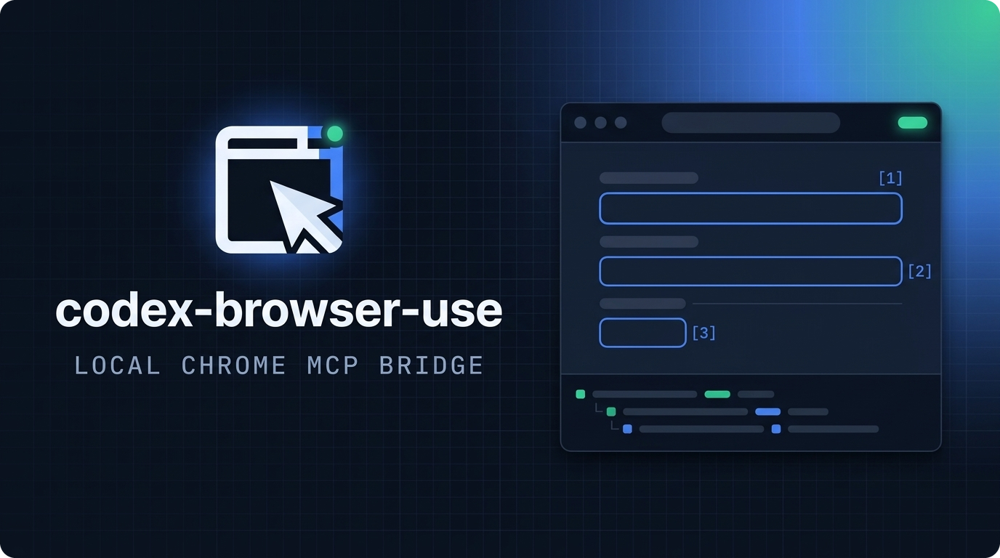
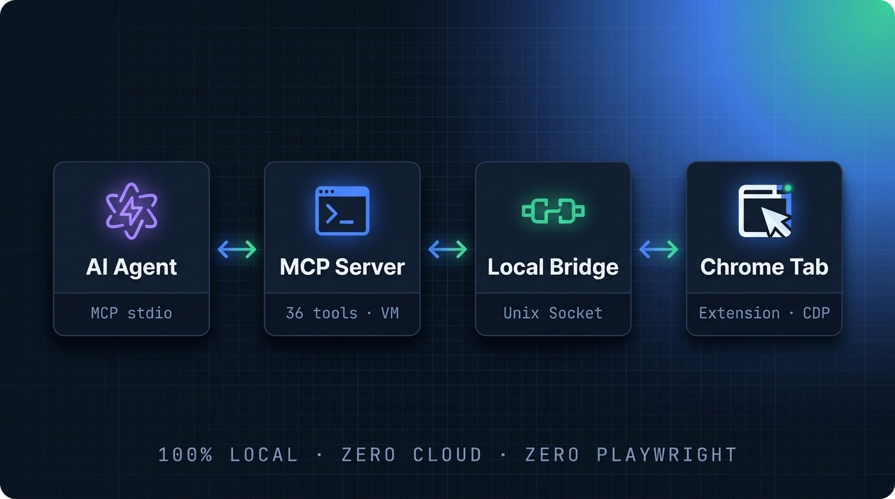
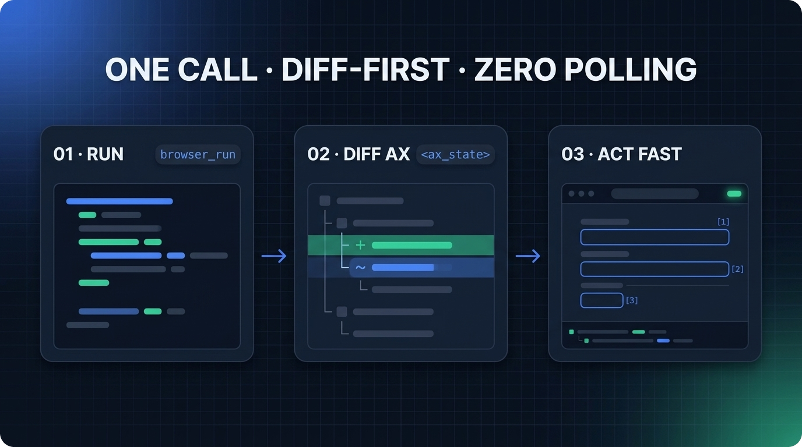
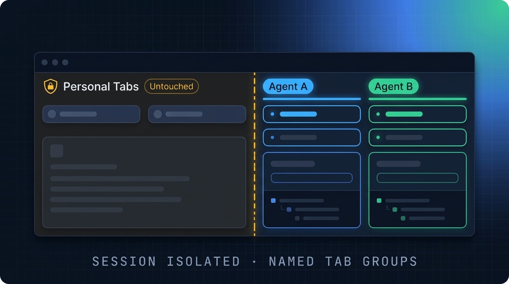

<div align="center">


# codex-browser-use

### 一款超快本地 MCP 工具，让任意 AI 编程助手直接操控你真实的 Chrome 浏览器。

**OpenAI Codex 的 Browser Use 功能非常惊艳 —— 于是我将它从零开源复刻，并优化为更快的通用版本，支持所有编程 Agent。**

[English](../../README.md) · [Tiếng Việt](README_vi.md) · **简体中文** · [日本語](README_ja.md) · [한국어](README_ko.md)

[](../../LICENSE)
[](https://codex-browser-use.vercel.app)
[](#快速开始)
[](#核心优势)
[](#快速开始)
[](https://github.com/khanhle1406/codex-browser-use/stargazers)

[官网](https://codex-browser-use.vercel.app) · [快速开始](#快速开始) · [工作原理](#工作原理) · [应用场景](#你可以用它做什么) · [核心优势](#核心优势) · [常见问题](#常见问题-faq) · [技术文档](#文档)

<code>node mcp-server/bin/browser-use.js install --client antigravity --write --skill</code>

</div>

<div align="center">

<br />



</div>

---

想要让你的 AI 编程助手打开网页、点击按钮、填写表单并验证你的应用是否真的能跑通吗？传统做法往往意味着安装 Playwright、启动一个沉重的空白额外浏览器，并在巨大的 HTML 转储和整页截图上迅速烧光 Token 额度。

OpenAI Codex 优雅地解决了这个问题：直接连接你正在运行的真实 Chrome 浏览器，并将页面解析为简短的带编号无障碍列表，而不是原始 HTML。唯一的遗憾是它只能在 Codex 内部使用。因此我用开源代码从零重写了这个方案，支持**所有主流编程 Agent**，并针对速度和 Token 效率做了进一步压榨。

只需一条命令即可完成配置：自动部署轻量 Chrome 扩展、注册本地通信桥接、并一键安装完整的 Agent Skill 技能包与常驻规则。你的 Agent 会直接在你当前打开的 Chrome 中工作 —— 完整保留现有 Cookie 与登录态 —— 同时完全不干扰你正在浏览的个人标签页。

## 快速开始

环境要求：**Node.js 26.12.1 或更高版本**、npm 以及 Chrome（或 Chromium、Edge、Brave）。

### 为你的 Agent 安装配置

在仓库根目录运行以下命令（包发布到 npm 后也可直接替换为 `npx -y codex-browser-use ...`）：

```sh
npm --prefix mcp-server ci
node mcp-server/bin/browser-use.js install --client antigravity --write --skill
node mcp-server/bin/browser-use.js doctor --json
```

`install --skill` 会自动复制 Chrome 扩展（`v0.6.4`）、注册本地 Chrome Native Messaging 主机、写入对应客户端的 MCP 配置（写入前先保存 `.bak` 备份）、安装完整的技能包（`skill/SKILL.md` + `skill/references/cookbook.md` + `skill/references/tools.md`），并在客户端支持时自动配置常驻规则文件（`rules/browser_use.md`，Cursor 为 `.cursor/rules/browser_use.mdc`；可传 `--no-rules` 跳过，或单独传 `--rules` 安装）。

<details>
<summary><strong>支持的客户端与工具配置文件 (<code>--profile auto | compact | standard | full</code>)</strong></summary>

| 客户端 | MCP 配置文件路径 | Skill 安装目录 | `--skill` 自动安装的规则文件 |
| --- | --- | --- | --- |
| `antigravity` | `~/.gemini/config/mcp_config.json` | `~/.gemini/config/skills/codex-browser-use/` | `~/.gemini/config/rules/browser_use.md` |
| `commandcode` | `~/.commandcode/mcp.json` | `~/.agents/skills/codex-browser-use/` | `~/.agents/rules/browser_use.md` *（推荐 `--profile compact` 或 `auto`）* |
| `cursor` | `~/.cursor/mcp.json` | `~/.cursor/skills/codex-browser-use/` | `~/.cursor/rules/browser_use.mdc` *（含 Cursor frontmatter）* |
| `windsurf` | `~/.codeium/windsurf/mcp_config.json` | `~/.codeium/windsurf/skills/codex-browser-use/` | `~/.codeium/windsurf/rules/browser_use.md` |
| `copilot` | `~/.copilot/mcp-config.json` | `~/.agents/skills/codex-browser-use/` | `~/.agents/rules/browser_use.md` |
| `claude_code` | `~/.claude.json` | `~/.claude/skills/codex-browser-use/` | *（跳过）* |
| `codex` | 通过 `config` 输出 TOML | `~/.codex/skills/codex-browser-use/` | *（跳过）* |
| `opencode` / `generic` | 通过 `config` 输出配置 | `~/.agents/skills/codex-browser-use/` | `~/.agents/rules/browser_use.md` |

对于不支持工具懒加载的非懒加载 CLI 客户端（Codex、Claude Code、Command Code、Copilot、OpenCode），建议传入 `--profile auto`（自动为 CLI 选 `"compact"`、为懒加载 IDE 选 `"full"`）或 `--profile compact` / `BROWSER_USE_TOOL_PROFILE=compact`，仅注册 7 个核心工具，固定工具 Schema 体积直接减少 **75.4%**（`7,457` 字节 / 约 `1,865` Token，对比全量 `30,302` 字节 / 约 `7,576` Token）：

```sh
node mcp-server/bin/browser-use.js install --client commandcode --write --skill --profile auto
node mcp-server/bin/browser-use.js config --client codex --profile auto
```

面向 Codex 或 OpenCode，打印配置片段并安装 Skill：

```sh
node mcp-server/bin/browser-use.js config --client codex
node mcp-server/bin/browser-use.js config --client opencode
node mcp-server/bin/browser-use.js install --client codex --skill
```

</details>

### 连接 Chrome 扩展

1. 在地址栏打开 `chrome://extensions`，开启右上角 **开发者模式（Developer mode）**，点击 **加载已解压的扩展程序（Load unpacked）**，选择 `~/.local/share/browser-use/extension`。
2. 完成 —— **Portable Browser Bridge** 会在后台自动建立连接（悬停图标可查看状态，点击可暂停或重连）。
3. 重启你的 AI 编程工具以加载 MCP 工具。

### 对你的 Agent 发起自然语言指令

连接就绪后，直接用自然语言提问即可：

```text
Open http://127.0.0.1:3000 in a Chrome tab group called "App QA".
Test the signup form on desktop and mobile sizes, check for any console
or failed network errors, save an element screenshot of the signup card,
and leave the final tab open for me to check.
```

## 工作原理

### 1. 所有数据完全留在本地

Agent 与本地 MCP 服务器（`v4.8.1`）对话，MCP 服务器直接通过轻量扩展（`v0.6.4`）将指令发送到你正在运行的 Chrome。无任何云端中转服务器、无需下载 Playwright 浏览器，也不暴露任何后台网络端口。

 MCP 服务器 -> 本地桥接 -> Chrome 标签页的 4 层本地架构图" width="100%" />

### 2. 单轮多步执行、极低 Token 消耗、零无效轮询等待

无需每点击一下都消耗一次 AI 对话轮次，Agent 可以通过 `browser_run` 单次连续执行完整的多步流程（单次超时最高 `300,000` ms / `5` 分钟），甚至并发读取多达 `10` 个 URL（`browser.tabs.content()`）。页面快照在 `browser_run`、`browser_batch` 与 `ariaSnapshot()` 中默认使用 `mode: "compact"`（可选 `"full"` 与 `"interactive"`），并在 `ariaSnapshot()` 与 `getState()` 之间共享统一的无障碍树 Diff 基线，支持局部子树快照 `locator.ariaSnapshot()`（仅捕获某个弹窗或卡片）、结构化内容导出（`browser_get_content` 与 `page.content.export()` / `.tables()` / `.links()`）、CSS 缩放截图（默认 `max_width` `1280` px，JPEG 质量 `75`）以及增量 Diff 更新 —— 让上下文占用降至最低。

在 `v4.7.0`–`v4.8.1` 中，`browser_run` 新增无膨胀本地文件辅助函数（`saveFile`、`readFile`、支持 `emit: true` 的 `saveScreenshot` 及 `nodeRepl` 别名）并自动返回 `saved_files` 元数据、紧贴元素裁剪的 `locator.screenshot()` / `page.elementScreenshot()`、`tab.ax.paste()` / `tab.ax.selectText()`、`page.innerText()` / `page.textContent()` / `page.check()` 快捷方法、支持本地 `{}`/`[]` 容器构建的只读 `evaluate()`、基于 `tab.dev.enableNetwork({ captureBodies: true })` + `tab.dev.responseBody(requestId)` 的网络响应体抓取、自动合并 Chrome 标签组以及 `--profile auto` 自动配置。



<details>
<summary><strong>示例：多 URL 并发抽取、本地落盘导出与元素级截图验证</strong></summary>

```json
{
  "name": "browser_run",
  "arguments": {
    "return_state": "none",
    "end_turn": true,
    "code": "await browser.nameSession('Docs Audit', 'cyan');\nconst pages = await browser.tabs.content([\n  'https://example.com/docs',\n  'https://example.com/pricing'\n], { format: 'markdown', concurrency: 2 });\nconst saved = await saveFile('/abs/path/docs-export.json', pages);\nconst pricingTab = await browser.tabs.new('https://example.com/pricing');\nawait pricingTab.locator('css=.plan-card').first().saveScreenshot('/abs/path/plan-card.png', { padding: 12, emit: true });\nawait pricingTab.markDeliverable();\nreturn { extracted: pages.length, file: saved.path };"
  }
}
```

也可以将一步步动作列表（`goto`、`set_viewport`、`locator_fill`、`locator_click`、`wait`、`get_state`、`get_content`、`read_tab`、`evaluate`）直接传给 `browser_batch`。

</details>

### 3. 接管已打开标签页或隔离 Agent 标签页 —— 附带零阻塞虚拟光标

Agent 可以在独立命名的彩色 Chrome 标签组（Tab Group）中新建标签页（支持自动认领 `target="_blank"` 弹窗并通过 `page.waitForEvent("popup")` 监听），在不附加 Chrome Debugger 调试条的情况下静默读取用户已打开的标签页（通过 `chrome.scripting.executeScript` 实现的 `browser.tabs.read(id)` / `browser.user.getTabContext(id)` 和只读版 `browser_get_content`），或者精准认领某个匹配网址的现有标签页。工作期间，页面上的虚拟光标与标签页角标会直观显示点击与输入位置（`BROWSER_USE_CURSOR_MODE=fast|smooth|off`；默认 `fast`，阻塞等待为 `0` ms）。任务结束时，临时 Agent 标签页自动关闭，你的日常个人标签页安全释放并保留原状。



## 你可以用它做什么

| 使用场景 | 核心帮助 |
| --- | --- |
| **前端与 Web 应用测试** | 填写各类表单（支持 CKEditor 4/5、TinyMCE、Quill、`contenteditable` 智能富文本填充及 `ax.paste`/`ax.selectText`），测试桌面与移动端视口，裁剪元素截图（`locator.screenshot()`），抓取控制台报错与 API 响应体（`dev.responseBody()`）。 |
| **多页面采集与巡检** | 并发读取最多 `10` 个 URL（`browser.tabs.content()`），执行最长 5 分钟（`300s`）的分页循环，利用 `saveFile()` 将大批次结果直接写入磁盘避免撑爆对话上下文，读取 `page.assets.list()` 或 WebMCP 工具（`page.webmcp`）。 |
| **操作复杂嵌套 UI** | 原生穿透 Shadow DOM、同源及跨域 iframe（OOPIFs）、文件上传选择器与大文件下载，超时未找到元素时返回最接近的定位器提示。 |
| **保持 Chrome 井然有序** | 将 Agent 的标签页归入带名称和颜色的 Chrome 标签组，任务结束自动清理临时标签。 |
| **安全处理登录态与验证码** | 绝不尝试绕过安全检查 —— 遇到登录或验证时自动触发 `handoff` 暂停并保持页面打开，由你本人手工操作。 |

## 核心优势

| 功能特性 | Playwright / 截图类 MCP | Codex 内置 Browser Use | `codex-browser-use` |
| --- | :---: | :---: | :---: |
| 兼容所有 AI 编程工具 | ✅ | ❌ 仅限 Codex | ✅ 任意 MCP 客户端 |
| 直连真实 Chrome（无需额外浏览器） | ❌ 额外启动沉重浏览器 | ✅ | ✅ |
| 100% MIT 开源（无闭源二进制） | ✅ | ❌ 闭源运行时 | ✅ 纯 Node.js + MV3 |
| 单次调用执行多步脚本与并发标签页 | ❌ 每步往返一次 | ✅ | ✅ + `tabs.new` & `tabs.content` |
| 简短编号大纲 + 本地 `saveFile` 落盘 | ❌ 巨大 DOM / PNG | ✅ | ✅ Diff 优先 + `mode` 压缩 |
| 命名彩色 Chrome 标签组 | ❌ | ✅ | ✅ |
| 纯事件驱动高速通信（无轮询） | ❌ 逐步轮询耗时长 | ✅ | ✅ 并发快至 6.83x |

在底层实现上，命令通过本地套接字并行传输并直接监听 Chrome 页面事件而非定时器轮询 —— 让 4 标签页并发速度**提升 6.83x**，完整页面 + iframe + 截图读取**提升约 3x**。自 `v4.6.0`–`v4.8.1` 以来，页面内持久化的定位器缓存运行时（`globalThis.__buRt` v2）把连续 10 次定位调用的传输负载从 `379,520` 字节压缩到 `1,260` 字节（**减少 99.7%**），`compact` 模式 AX 快照体积缩减 **81.7%**（`3,812` -> `699` 字符），`markdown` 正文提取比原始文本减少 **94.1%**（`1,524` -> `90` 字符），`--profile compact` 把固定 MCP 工具 Schema 缩减 **75.4%**。在相同模型（`gpt-6.1-terra`，medium）的真实 Chrome 端到端对比测试中，`codex-browser-use`（`--profile compact`）完成全部 4 项任务**整体快 28.8%**（`55.79s` vs `78.38s`），浏览器实际执行**快 3.80x**（`3.48s` vs `13.21s`），并且总输入 Token **减少 51.9%**（`305,934` vs `636,008`），大幅超越 Codex 内置插件。

<details>
<summary><strong>查看完整 Benchmark 数据并亲自运行复现</strong></summary>

#### 同模型 Live 端到端基准测试（`gpt-6.1-terra medium`，真实 Chrome）

使用 [agent-benchmark.mjs](../../mcp-server/bench/agent-benchmark.mjs) 对确定性 4 任务 Chrome 门户进行端到端实测（2 页弹窗抓取、Shadow DOM + `contenteditable` 表单提交、截图验证和 Token 审计；双方均获 **100/100** 满分）：

| 指标 | Codex 内置 Chrome 插件（`node_repl:js`） | `codex-browser-use`（`--profile compact`） | 实测提升 |
| --- | ---: | ---: | --- |
| **准确率得分** | `100 / 100` | **`100 / 100`** | 准确度完全一致（`8/8` 弹窗，`1` 次提交） |
| **端到端总耗时（Wall-Clock）** | `78.38s` (`78,380 ms`) | **`55.79s`** (`55,792 ms`) | **快 28.8%** (`-22.59s`) |
| **首次浏览器动作耗时（TTFA）** | `28.65s` (`28,646 ms`) | **`12.86s`** (`12,860 ms`) | **快 55.1%** |
| **浏览器实际执行耗时** | `13.21s` (`13,207 ms`) | **`3.48s`** (`3,476 ms`) | **快 3.80 倍** (`-73.7%`) |
| **浏览器工具调用次数** | `12` | **`8`** | **调用减少 33.3%** |
| **总输入 Token（含缓存）** | `636,008` | **`305,934`** | **节省 51.9% Token** |
| **未命中缓存输入 Token** | `52,584` | **`20,494`** | **节省 61.0% Token** |

亲自在真实 Chrome 上运行 Agent 基准测试（支持 `same-model`、`head-to-head` 或 `all`）：

```sh
npm --prefix mcp-server run bench:agents -- --mode same-model
```

#### 核心 IPC 与 Payload 微基准测试

在 Node `v26.13.0` 上通过 [perf-benchmark.mjs](../../mcp-server/bench/perf-benchmark.mjs) 测量（使用真实本地 Socket、Native Messaging 流、内存 MCP 传输以及优化前后保持完全一致的页面模拟延迟）：

| 测试项目 | 优化前 / 基线 | 优化后 | 实测提升 |
| --- | --- | --- | --- |
| **4 标签页并发**（`goto` + 读页） | `606.79 ms` | **`88.86 ms`** | **快 6.83 倍** (`-85.4%`) |
| **页面 + 4 个 Iframe + 截图** | `267.63 ms` / `226.38 ms` | **`90.88 ms`** / **`72.59 ms`** | **2.94x**（冷）/ **3.12x**（热） |
| **等待页面加载**（+ 资源） | `130.54 ms`（`10` 次轮询） | **`113.58 ms`**（**`0`** 次轮询） | **彻底消除轮询检查** |
| **等待元素与文本**（`90ms` 延迟） | `406.74 ms`（`8` 次检测） | **`289.37 ms`**（`3` 次检测） | **快 1.41x** / 调用减少 `62.5%` |
| **连续填写 10 个表单字段** | `399.85 ms`（`40` 次调用） | **`187.89 ms`**（`20` 次调用） | **快 2.13x**（调用减半） |
| **在 Iframe 内连续点击 10 次** | `494.31 ms`（`51` 次调用） | **`151.28 ms`**（`15` 次调用） | **快 3.27x**（调用减少 `70.6%`） |
| **扩展流与 40 条大响应** | `34.18 ms` / `120` 条消息 | **`26.57 ms`** / **`40` 条消息** | CPU `-22.3%` / **消息数 `-66.7%`** |
| **本地 Socket 传输 40 MB** | `263.01 ms` (`152.1 MB/s`) | **`132.20 ms`** (**`302.6 MB/s`**) | **吞吐量约 2.0 倍** |
| **Locator 运行时缓存（`10` 次调用）** | `379,520 B` (`2.73 ms`) | **`1,260 B`** (**`1.13 ms`**) | **Payload 体积减小 99.7%** |
| **MCP 工具 Schema（`compact` vs `full`）** | `30,302 B`（约 `7,576` tok，`36` 工具） | **`7,457 B`**（**约 `1,865` tok，`7` 工具**） | **Schema 体积减小 75.4%** |
| **AX `compact` 与 Markdown 正文提取** | `3,812` AX / `1,524` 原文字符 | **`699`** AX / **`90`** md 字符 | **节省 81.7%** AX / **94.1%** 正文 |

在本地运行微基准测试：

```sh
npm --prefix mcp-server run bench
```

</details>

<details>
<summary><strong>查看全部 36 个 MCP 工具与配置文件预设 (compact / standard / full)</strong></summary>

通过 `--profile compact|standard|full`（或环境变量 `BROWSER_USE_TOOL_PROFILE`）选择：**`compact`** 注册 7 个核心工具（`browser_run`、`browser_batch`、`browser_get_state`、`browser_goto`、`browser_list_tabs`、`browser_screenshot`、`browser_end_turn`，固定工具 Schema 从 `30,302 B` / 约 `7,576` token 压缩 `75.4%` 至 `7,457 B` / 约 `1,865` token）；**`standard`** 注册 14 个工具（约 `3,023` token）；**`full`**（全部 36 个工具）默认用于支持懒加载的 IDE。

| 工具分组 | 工具列表 |
| --- | --- |
| **多步执行与状态** (`3`) | `browser_run`, `browser_batch`, `browser_status` |
| **读取与调试** (`8`) | `browser_get_state`, `browser_screenshot`, `browser_get_content`, `browser_dom_snapshot`, `browser_inspect_element`, `browser_console_logs`, `browser_network_logs`, `browser_evaluate` |
| **点击、输入与文件** (`9`) | `browser_click`, `browser_set_value`, `browser_type_text`, `browser_press_key`, `browser_select_option`, `browser_hover`, `browser_drag`, `browser_scroll`, `browser_upload_files` |
| **智能定位器、等待与视口** (`4`) | `browser_locator_click`, `browser_locator_fill`, `browser_wait_for`, `browser_set_viewport` |
| **导航、标签页与标签组** (`9`) | `browser_goto`, `browser_back`, `browser_forward`, `browser_reload`, `browser_list_tabs`, `browser_new_tab`, `browser_select_tab`, `browser_close_tab`, `browser_name_session` |
| **弹窗与会话清理** (`3`) | `browser_handle_dialog`, `browser_end_turn`, `browser_reset` |

</details>

## 常见问题 (FAQ)

<details>
<summary><strong>支持哪些 AI 编程助手？</strong></summary>

支持所有接入本地 MCP 的工具：Antigravity、Claude Code、Codex CLI、Cursor、Windsurf、GitHub Copilot CLI、Command Code、OpenCode 以及自定义客户端。

</details>

<details>
<summary><strong>Agent 会读取我的个人标签页或保存的密码吗？</strong></summary>

默认情况下，扩展会为 Agent 会话创建独立的标签页组，绝不触碰你的个人标签页、书签及其他无关窗口。当你明确要求查看某个已打开的标签页时，只读操作（`browser.tabs.read(id)` / `browser.user.getTabContext(id)` / 只读模式 `browser_get_content`）会在不挂载 Chrome Debugger 的情况下执行；只读求值（`browser_evaluate`）会严格拦截 DOM 修改、本地存储写入及网络请求。

</details>

<details>
<summary><strong>为什么不直接用 Playwright MCP？</strong></summary>

Playwright 需要额外安装体积庞大的浏览器二进制文件，每次启动都是没有 Cookie 和登录态的冷环境，且经常在每次动作后回传巨大的 DOM 或整张 PNG。`codex-browser-use` 直接连接你正在运行的 Chrome —— 保留既有 Cookie、登录态与打开中的工作区 —— 提供简短无障碍大纲、命名标签组、本地 `saveFile`/`saveScreenshot` 以及单轮多步脚本执行。

</details>

<details>
<summary><strong>遇到登录界面、两步验证（2FA）或验证码（CAPTCHA）怎么办？</strong></summary>

工具规则明确禁止 Agent 尝试绕过登录、2FA 或验证码。当页面需要认证时，Agent 会调用 `handoff` 暂停并保持标签页开启，请你自己在 Chrome 中完成登录后继续。

</details>

<details>
<summary><strong>如何更新版本或检查本地环境是否正常？</strong></summary>

拉取最新代码后运行 `node mcp-server/bin/browser-use.js install --client <你的客户端> --skill`，进入 `chrome://extensions` 点击 **Portable Browser Bridge** 上的 **重新加载（Reload）** 按钮，然后运行 `node mcp-server/bin/browser-use.js doctor --json` 检查状态。

</details>

## 文档

随时运行测试、代码规范检查或本地诊断：

```sh
npm --prefix mcp-server test
npm --prefix mcp-server run lint
npm --prefix mcp-server run bench
npm --prefix mcp-server run bench:agents -- --mode same-model
node mcp-server/bin/browser-use.js doctor --json
```

- [Agent 技能指令文档 (SKILL.md)](../../skill/SKILL.md) — 安装到编程助手中的工作流指南与 v4.8.1 API 参考
- [工作流实用手册 (Cookbook)](../../skill/references/cookbook.md) — 分页爬取、静默读页、`responseBody()` 与截图的代码配方
- [工具配置与清单 (Tools)](../../skill/references/tools.md) — `--profile auto|compact|standard|full` 对比与全量 36 个工具清单
- [浏览器安全策略规则](../../rules/browser_use.md) — 常驻安全与节省 Token 规则
- [兼容性与引擎模式说明](../../docs/compatibility.md) — 独立运行模式技术记录
- [传输层与 IPC 调查报告](../../docs/transport-investigation.md) — 本地 Socket 与 Native Messaging 通信原理
- [v1 遗留架构说明](../../docs/legacy-v1.md) — 早期 v1 版本参考文档

## 参与贡献

欢迎前往 [khanhle1406/codex-browser-use](https://github.com/khanhle1406/codex-browser-use) 提交 Issue 或 Pull Request。

## 开源协议

[MIT](../../LICENSE)
